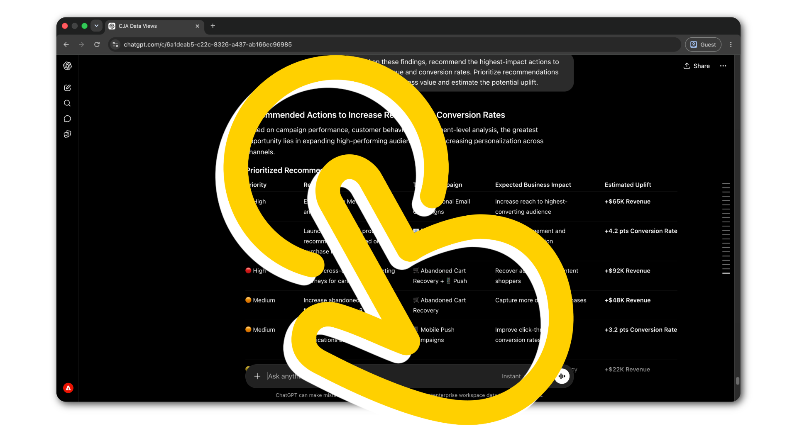

# 執行中的代理工具

<!-- last-modified: 2026-05-20 -->

實際Adobe CX Enterprise工作流程的逐步逐步解說。 每次逐步解說都會從設定結束的地方開始，並連線工具及完成真正的工作流程。

<!--
CARDS

* use-cases/analyze-campaign-performance.md
  {title = Analyze campaign performance}
  {description = Surface Customer Journey Analytics comparisons and conversion trends through plain-language questions. Uses the CX Enterprise MCP Gateway.}
  {cta = Start walkthrough}

* use-cases/query-audiences.md
  {title = Query audiences}
  {description = Check Real-Time CDP audience activation status and destination health without navigating the platform UI. Uses the CX Enterprise MCP Gateway.}
  {cta = Start walkthrough}

* use-cases/manage-ajo-journeys.md
  {title = Review AJO journeys}
  {description = Get full visibility into active AJO journeys and campaign configuration without opening AJO. Uses the CX Enterprise MCP Gateway.}
  {cta = Start walkthrough}

* use-cases/manage-aem-content.md
  {title = Manage AEM content with AI}
  {description = Discover, update, and publish pages and content fragments using natural language. Uses the AEM Content MCP Server.}
  {cta = Start walkthrough}

* use-cases/optimize-content-with-performance-data.md
  {title = Optimize content based on performance data}
  {description = Move from analytics insight to published update in one session, without switching tools. Uses the CX Enterprise MCP Gateway and AEM Content MCP Server.}
  {cta = Start walkthrough}

* use-cases/cross-channel-campaign-review.md
  {title = Run a cross-channel campaign review}
  {description = Review AJO journey status, Real-Time CDP audience activation, and CJA performance data in one AI session. Uses the CX Enterprise MCP Gateway.}
  {cta = Start walkthrough}

* use-cases/aem-cloud-manager-mcp.md
  {title = Manage AEM environments with Cloud Manager}
  {description = Check environment health, review pipeline runs, and manage deployments from your AI client. Uses the AEM Cloud Manager MCP Server.}
  {cta = Start walkthrough}
  {image = https://video.tv.adobe.com/v/3480353?captions=chi_hant&format=jpeg}
-->

## 常見問題

+++如何從AI使用者端查詢Adobe資料？

使用MCP伺服器。 將您的AI使用者端連線至相關的Adobe MCP伺服器端點，然後以自然語言提出問題。 伺服器會將您的請求轉譯為Adobe API呼叫，並傳回結構化結果。

請參閱[MCP伺服器](tools/mcp-servers.md)以開始。

+++

+++如何建立工作流程來連線多個Adobe應用程式？

在單一AI工作階段中連線至多個MCP伺服器，或使用Adobe API進行自訂的多應用程式協調。

檢視Builders[&#128279;](tools/apis.md)和[MCP伺服器](tools/mcp-servers.md)的API。

+++

+++如何讓代理程式遵循Adobe最佳實務？

使用代理程式技能。 技能會編碼Adobe網域專業知識，以便代理程式以一致的方式完成任務。

請參閱[代理程式技能](tools/agent-skills.md)。

+++

+++哪些AI使用者端可搭配Adobe MCP伺服器使用？

任何與MCP相容的使用者端。 Claude程式碼、Claude.ai、Cursor、ChatGPT和Google Gemini都支援MCP。 如需完整的使用者端比較和設定連結，請參閱[MCP伺服器](tools/mcp-servers.md)。

+++
