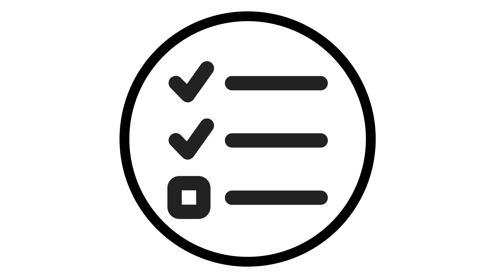
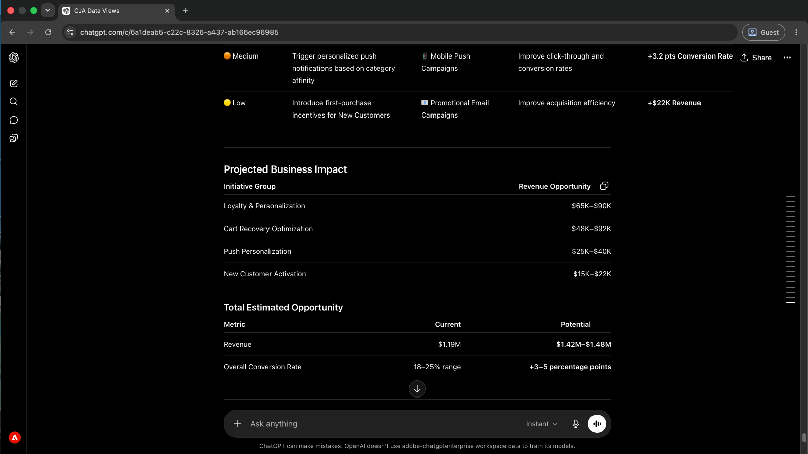
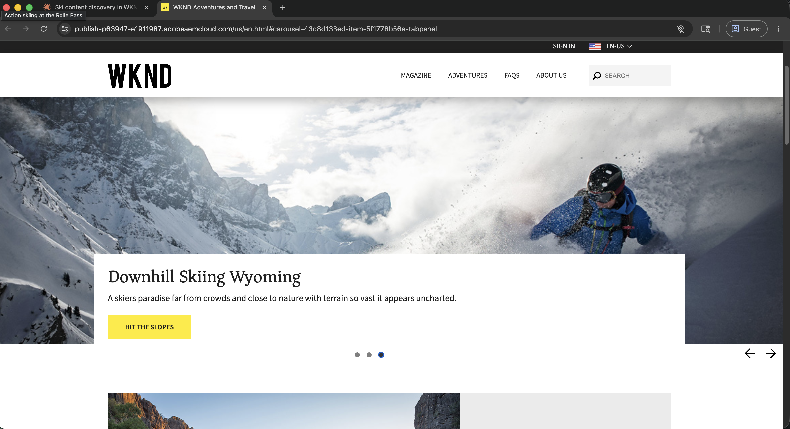

# Adobe CX Enterprise Agentic Tools

<!-- last-modified: 2026-06-08 -->

>[!VIDEO](https://video.tv.adobe.com/v/3491235/?learn=on&enablevpops)

讓AI成為您的Adobe CX Enterprise共同作業人員。 將您的AI使用者端連線至行銷活動、對象、歷程和內容。 使用您已經使用的任何工具，以簡單的語言與他們互動。 沒有新介面、沒有內容切換、不需要編碼即可開始。

>[!TIP]
>**從CX Enterprise MCP開始。** 一個連線可讓您的AI使用者端根據您組織的授權存取Adobe Journey Optimizer、Customer Journey Analytics和Real-Time CDP。 [立即連線](tools/mcp-servers.md#cx-enterprise-mcp-servers)

<!--
CARDS

* tools/mcp-servers.md
  {title = MCP Servers}
  {description = Connect any MCP-compatible AI client to Adobe CX Enterprise workflows. Query data, analyze campaigns, and access audiences without leaving your AI tool.}
  {cta = Explore MCP Servers}
  {image = assets/mcp-servers-card.png}

* tools/agent-skills.md
  {title = Agent Skills}
  {description = Adobe-curated workflows that guide agents through CX Enterprise tasks. Domain expertise encoded once, applied consistently.}
  {cta = Explore Agent Skills}
  {image = assets/agent-skills-card.png}

* tools/apis.md
  {title = APIs for Builders}
  {description = Build custom Adobe CX Enterprise applications using agentic coding tools like Claude Code and Cursor.}
  {cta = Explore APIs for Builders}
  {image = assets/apis-card.png}
-->
<!-- START CARDS HTML - DO NOT MODIFY BY HAND -->

    

        

            

                <figure class="image x-is-16by9">
                    
                </figure>
            

            

                

                    

                        <a href="tools/mcp-servers.md" title="MCP伺服器">MCP伺服器</a>
                    

                    
將任何與MCP相容的AI使用者端連線至Adobe CX Enterprise工作流程。 在不離開AI工具的情況下查詢資料、分析行銷活動以及存取對象。

                

                <a href="tools/mcp-servers.md" class="spectrum-Button spectrum-Button--outline spectrum-Button--primary spectrum-Button--sizeM" style="align-self: flex-start; margin-top: 1rem;">
                    探索MCP伺服器
                </a>
            

        

    

    

        

            

                <figure class="image x-is-16by9">
                    
                </figure>
            

            

                

                    

                        <a href="tools/agent-skills.md" title="代理程式技能">代理程式技能</a>
                    

                    
由Adobe組織的工作流程，可引導代理程式完成CX Enterprise工作。 網域專業知識編碼一次，並一致套用。

                

                <a href="tools/agent-skills.md" class="spectrum-Button spectrum-Button--outline spectrum-Button--primary spectrum-Button--sizeM" style="align-self: flex-start; margin-top: 1rem;">
                    探索代理程式技能
                </a>
            

        

    

    

        

            

                <figure class="image x-is-16by9">
                    
                </figure>
            

            

                

                    

                        建置器的<a href="tools/apis.md" title="適用於建置器的API">API</a>
                    

                    
使用Claude Code和Cursor等代理程式編碼工具建置自訂Adobe CX Enterprise應用程式。

                

                <a href="tools/apis.md" class="spectrum-Button spectrum-Button--outline spectrum-Button--primary spectrum-Button--sizeM" style="align-self: flex-start; margin-top: 1rem;">
                    探索建置器的API
                </a>
            

        

    

<!-- END CARDS HTML - DO NOT MODIFY BY HAND -->

## 適用於每個團隊的代理工具

>[!BEGINTABS]

>[!TAB MCP伺服器]

使用任何相容的AI使用者端，以簡單語言存取CX Enterprise應用程式。 不需要編碼。 從CX Enterprise MCP開始，單一連線至AJO、CJA和Real-Time CDP，或直接連線至AEM和其他應用程式。

- 在幾分鐘內從Claude、Cursor、ChatGPT和其他與MCP相容的使用者端連線
- 使用自然語言查詢行銷活動、對象和歷程資料
- 不需要新的介面或訓練

[開始使用MCP伺服器](tools/mcp-servers.md)

>[!TAB 代理程式技能]

「代理商技能」會編碼Adobe網域專業知識，作為您的AI使用者端可遵循的指示。 此代理程式不會即興發揮，而是確切知道要做什麼、可靠、可重複執行，並符合Adobe最佳實務。

- 可重複的CX Enterprise工作流程的一致結果
- 無需向代理程式說明Adobe：技能能處理
- 在支援代理程式技能的AI使用者端間運作

[探索代理程式技能](tools/agent-skills.md)

>建置器的[!TAB API]

以程式設計方式直接存取支援Adobe產品的相同API。 建立自訂的應用程式和整合，讓您的團隊能夠專注且控管特定CX Enterprise工作流程。

- 建置一次，並在整個組織內部署
- 新增護欄、核准和團隊需要的自訂邏輯
- 使用Claude Code、Cursor和其他代理程式編碼工具來建置更快的程式碼

[探索建置器的API](tools/apis.md)

>[!ENDTABS]

## 執行中的代理工具

瞭解Adobe CX Enterprise代理程式工具在實務中的樣子。 每個逐步解說都會涵蓋從設定到結果的真實商業案例，具體說明如何連結AI使用者端、應問事項以及回訪內容。

<!--
CARDS

* use-cases/analyze-campaign-performance.md
  {title = Campaign insights without reports}
  {description = Ask performance questions in plain language and get answers from Customer Journey Analytics, without building a single report.}
  {cta = Surface campaign insights}

* use-cases/manage-aem-content.md
  {title = Ship content updates faster}
  {description = Find, update, and publish AEM pages and content fragments faster, without switching to the AEM interface.}
  {cta = Ship content faster}

-->
<!-- START CARDS HTML - DO NOT MODIFY BY HAND -->

    

        

            

                <figure class="image x-is-16by9">
                    
                </figure>
            

            

                

                    

                        <a href="use-cases/analyze-campaign-performance.md" title="不含報表的行銷活動深入分析">沒有報表的行銷活動深入分析</a>
                    

                    
以簡單的語言提出效能問題，並從Customer Journey Analytics獲得答案，而不需要建立單一報表。

                

                <a href="use-cases/analyze-campaign-performance.md" class="spectrum-Button spectrum-Button--outline spectrum-Button--primary spectrum-Button--sizeM" style="align-self: flex-start; margin-top: 1rem;">
                    表面行銷活動深入分析
                </a>
            

        

    

    

        

            

                <figure class="image x-is-16by9">
                    
                </figure>
            

            

                

                    

                        <a href="use-cases/manage-aem-content.md" title="加快傳送內容更新的速度">快送出內容更新</a>
                    

                    
無需切換至AEM介面，即可更快速地尋找、更新和發佈AEM頁面和內容片段。

                

                <a href="use-cases/manage-aem-content.md" class="spectrum-Button spectrum-Button--outline spectrum-Button--primary spectrum-Button--sizeM" style="align-self: flex-start; margin-top: 1rem;">
                    快送內容
                </a>
            

        

    

<!-- END CARDS HTML - DO NOT MODIFY BY HAND -->

**[檢視所有逐步說明](use-cases/overview.md)**

## Adobe資源

| 資源 | 您會找到的內容 |
| --- | --- |
| [Adobe AI登入](https://developer.adobe.com/ai-registry/?type=mcp) | 特定Adobe MCP伺服器的受管理聯結器和伺服器詳細資料 |
| [Adobe代理程式技能](https://github.com/adobe/skills) | 適用於CX Enterprise工作流程的Adobe組織代理程式技能 |
| [Adobe API目錄](https://developer.adobe.com/apis) | 完整Adobe CX Enterprise API參考 |
| [Adobe Developer Console](https://developer.adobe.com/developer-console/docs/guides/) | API專案設定和驗證 |
| [Adobe Admin Console](https://adminconsole.adobe.com) | 使用者和產品存取管理 |
| [Experience League](https://experienceleague.adobe.com/zh-hant/docs/experience-cloud-ai/experience-cloud-ai/home) | 完整的Adobe應用程式檔案與教學課程 |
