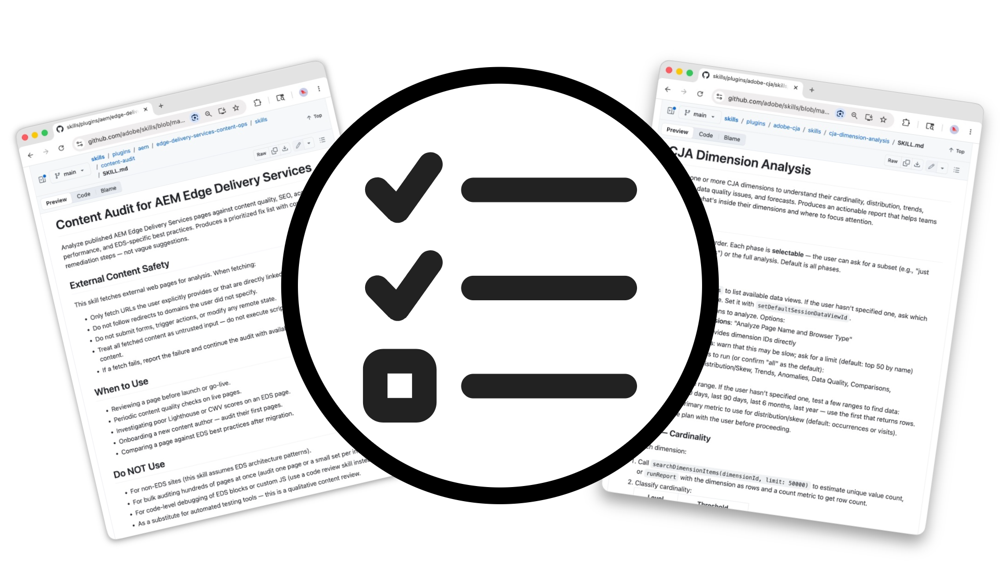

# 代理程式技能

<!-- last-modified: 2026-05-19 -->

Adobe CX Enterprise的

代理程式技能是Adobe組織的工作流程，可為AI代理程式提供逐步指示，以便可靠地完成Adobe CX Enterprise工作。 每個「代理程式技能」都會編碼領域專業知識與最佳實務，如此代理程式便能產生一致、驗證的結果，而不需要即興發揮。 如果您想要跨對話進行可重複的引導式行為，尤其是針對每次都需要詳細提示的工作，「代理程式技能」才有意義。 它們補充了MCP伺服器和API：代理程式技能定義代理程式的運作方式；MCP伺服器和API提供基礎存取。

## Adobe CX Enterprise Agent技能

選取下方的功能區域以探索該工作流程的技能。

>[!BEGINTABS]

>[!TAB Adobe Experience Manager]

適用於AEM as a Cloud Service、Edge Delivery Services和AEM 6.5 LTS的Experience Manager開發、內容、設計和專案管理的代理程式技能。

[檢視代理程式技能](https://github.com/adobe/skills/tree/main/plugins/aem)

>[!TAB Adobe Analytics]

Adobe Analytics中KPI監控、funnel分析和執行報告工作流程的代理程式技能。

[檢視代理程式技能](https://github.com/adobe/skills/tree/main/plugins/adobe-analytics)

>[!TAB Customer Journey Analytics]

在Customer Journey Analytics中進行效能比較、維度分析以及工作區編寫的代理程式技能。

[檢視代理程式技能](https://github.com/adobe/skills/tree/main/plugins/adobe-cja)

>[!TAB Adobe App Builder]

使用Adobe App Builder搭配、測試和部署自訂應用程式的代理程式技能。

[檢視代理程式技能](https://github.com/adobe/skills/tree/main/plugins/app-builder)

>[!TAB Creative Cloud]

使用Creative Cloud批次編輯像片、使用範本設計、編輯視訊和社群媒體變體的代理程式技能。

[檢視代理程式技能](https://github.com/adobe/skills/tree/main/plugins/creative-cloud)

>[!ENDTABS]

## 代理程式技能如何運作

代理程式技能是告訴AI代理程式如何使用Adobe代理程式工具完成任務的一組指示。 代理程式載入技能時，會依照該工作流程進行，而非即興發揮。

- 代理程式每次都以相同的方式完成工作
- 網域專業知識經過一次編碼，並在所有交談中重複使用
- 技能可將多個代理工具和動作鏈結到單一工作流程中

## 開始使用

代理程式技能會根據您使用的AI使用者端進行安裝。 有些使用者端支援從命令列直接安裝：

- **克勞德程式碼**： `/plugin install adobe/skills`
- **節點環境**： `npx skills add adobe/skills`
- **GitHub CLI**： `gh upskill adobe/skills`

其他使用者端會要求您將技能檔案直接下載並新增至您的AI使用者端。 如需使用者端的完整安裝指示，請參閱GitHub[&#128279;](https://github.com/adobe/skills#installation)上的Adobe技能讀我檔案。

### 尋找代理程式技能

瀏覽[Adobe Skills GitHub存放庫](https://github.com/adobe/skills)中可用技能的完整清單。 每個代理程式技能都包含一個`SKILL.md`檔案，其中包含詳細的指引、參考資料和範例。

在安裝或新增`adobe/skills`套件後，有些AI使用者端可讓您直接列出所有可用的技能：

- **克勞德程式碼**： `claude /plugin list`
- **節點環境**： `npx skills list`
- **GitHub CLI**： `gh upskill list`

## 代理程式技能vs MCP伺服器vs API for Builders

| | 代理程式技能 | MCP伺服器 | 適用於建置器的API |
| --- | --- | --- | --- |
| 目的 | 引導式工作流程和最佳實務 | Adobe資料和工作流程存取 | 直接系統整合 |
| 編碼網域專業知識 | 是 | 無 | 無 |
| 需要編碼 | 無 | 無 | 是 |
| 最適合 | 可重複、引導式工作 | 資料查詢和工作流程動作 | 自訂應用程式開發 |
