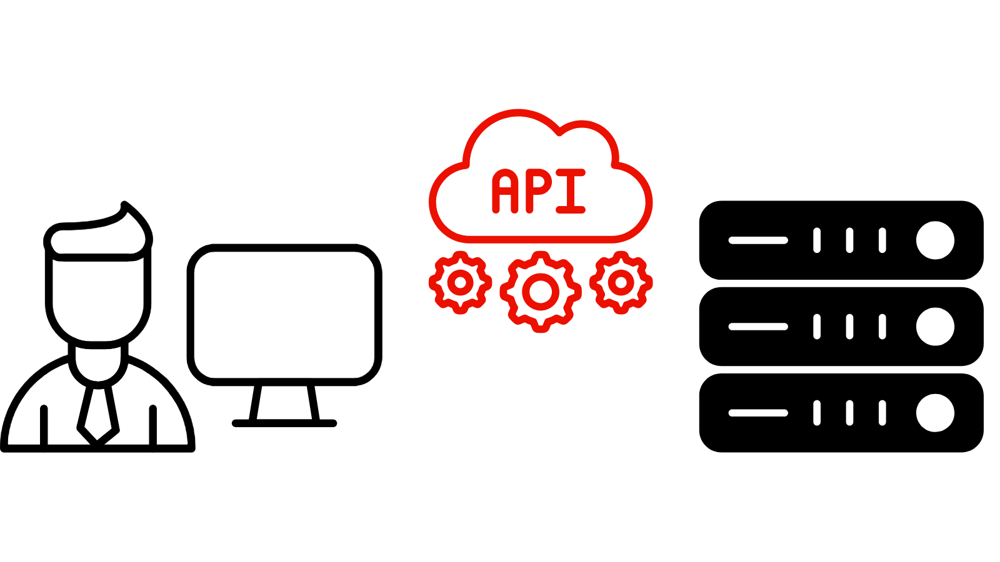

# 適用於建置器的API

<!-- last-modified: 2026-06-02 -->


Adobe CX Enterprise API可讓開發人員和AI輔助編碼代理工具直接存取Adobe資料和工作流程。 使用這些功能來建立自訂應用程式、自動化整合，並將Adobe功能內嵌到您自己的系統中。 當您需要以程式設計方式完整控制系統整合，或需要以Adobe資料為基礎建立應用程式時，API是您正確的選擇。 如需代理程式導向的對話式存取Adobe工作流程，請參閱[MCP伺服器](mcp-servers.md)。

## Adobe CX Enterprise API

>[!BEGINTABS]

>[!TAB Adobe Analytics]

報表、資料摘要、計算量度和區段管理。

[探索API](https://developer.adobe.com/analytics-apis/docs/2.0/)

>[!TAB Adobe Commerce]

目錄、購物車、訂單、客戶和促銷活動的REST和GraphQL API。

[探索API](https://developer.adobe.com/commerce/webapi/)

>[!TAB Adobe Experience Platform]

針對資料集、結構描述、設定檔、身分、查詢和分段的CRUD操作。

[探索API](https://developer.adobe.com/experience-platform-apis/)

>[!TAB Adobe Journey Optimizer]

歷程協調、行銷活動管理、內容範本和Offer Decisioning。

[探索API](https://developer.adobe.com/journey-optimizer-apis/)

>[!TAB AEM as a Cloud Service]

Adobe Experience Manager的內容、資產和工作流程管理API。

[探索API](https://experienceleague.adobe.com/en/docs/experience-manager-cloud-service/content/implementing/developing/apis-and-extensions)

>[!TAB Audience Manager]

對象管理和啟用工作流程。

[探索API](https://developer.adobe.com/audience-manager/)

>[!TAB 使用者端SDK]

行動SDK、邊緣SDK和應用程式內傳訊。

[探索API](https://developer.adobe.com/client-sdks/home/)

>[!TAB Customer Journey Analytics]

Analytics資料存取、報告和CJA見解工作流程。

[探索API](https://developer.adobe.com/cja-apis/docs/)

>[!TAB 資料收集]

Edge Network資料擷取、即時事件收集和串流資料傳送。

[探索API](https://developer.adobe.com/data-collection-apis/docs/)

>[!TAB Developer Console]

API專案設定、驗證和認證管理。

[探索API](https://developer.adobe.com/developer-console/docs/guides/)

>[!TAB 活動]

事件導向的整合、Webhook和自動化觸發器。

[探索API](https://developer.adobe.com/events/docs/)

>[!TAB 隱私]

隱私權工作流程、資料控管和資料主體請求。

[探索API](https://experienceleague.adobe.com/zh-hant/docs/experience-platform/privacy/home)

>[!TAB 用戶管理]

使用者管理、身分管理和企業帳戶自動化。

[探索API](https://developer.adobe.com/umapi/)

>[!ENDTABS]

## 使用API建置


編碼代理程式（例如Claude Code、Cursor和OpenAI Codex）非常適合使用Adobe CX Enterprise API來建置。 將OpenAPI規格新增到您的專案，代理程式就可以探索端點、建構請求，以及有關API行為的原因，而無需手動佈線。 若要開始，您需執行下列兩個操作：來自Adobe Developer Console的已驗證認證，以及新增至專案的API檔案。

### 在Adobe Developer Console中設定API認證

所有Adobe CX Enterprise API存取是透過[Adobe Developer Console](https://developer.adobe.com/developer-console/docs/guides/)管理。 建立專案、新增應用程式需求的API並產生認證。

1. 登入並在Adobe Developer Console中[建立專案](https://developer.adobe.com/developer-console/docs/guides/projects/)。
2. [新增您所需的Adobe CX Enterprise應用程式的API](https://developer.adobe.com/developer-console/docs/guides/services/)。
3. 選擇[驗證型別](https://developer.adobe.com/developer-console/docs/guides/authentication/)。 將&#x200B;**OAuth伺服器對伺服器**&#x200B;用於自動化工作流程，或將&#x200B;**OAuth Web應用程式**&#x200B;用於面向使用者的應用程式。
4. 產生您的認證。 請注意使用者端ID、使用者端密碼和權杖端點是否用於您的應用程式。

大部分的Adobe CX Enterprise API都需要應用程式授權。 如果您的Developer Console專案無法使用API，請聯絡您的Adobe代表。

### 將Adobe API內容新增至專案

當您將正確的參考資料新增到專案時，AI編碼代理程式可以可靠地探索和使用Adobe API。 適用於任何已發佈OpenAPI規格的Adobe CX Enterprise API。

**1. 尋找API規格**

瀏覽上方列出的[Adobe CX Enterprise API](#adobe-cx-enterprise-apis)，或直接前往[Adobe Developer API目錄](https://developer.adobe.com/apis)。

**2. 下載OpenAPI規格**

在您的專案中建立`/specs`目錄。 從[developer.adobe.com](https://developer.adobe.com/apis)上的API參考頁面下載OpenAPI YAML並儲存在該處。 新增`README.md`以記錄來源URL和下載日期。

```
/specs/README.md
/specs/aem-assets.openapi.yaml
```

>[!TIP]
>簽入的快照可為您的編碼代理程式提供穩定、可重複的行為，並使API變更顯示在您的Git記錄中。

**3. 產生API索引**

將此提示貼到您的程式碼代理程式中，將`<API-SPEC-FILE>`取代為您的檔案名稱：

```
Read /specs/<API-SPEC-FILE>.openapi.yaml and generate /docs/<API-SPEC-FILE>.api.md.

Create a concise API index for AI coding agents. For each operation include: operationId, HTTP method, path, purpose, authentication requirements, required inputs, response shape, common error responses, pagination behavior, asynchronous behavior, and deprecation status.

Do not invent endpoints, parameters, request bodies, response fields, or behavior not present in the OpenAPI specification.
```

**4. 產生代理程式指示**

```
Read /specs/<API-SPEC-FILE>.openapi.yaml and /docs/<API-SPEC-FILE>.api.md.

Generate AGENTS.md. Instructions should:
- Treat the OpenAPI specification as the source of truth.
- Use the API index as a navigation guide.
- Never invent endpoints, parameters, response fields, or status codes.
- Prefer documented operationIds.
- Avoid deprecated or experimental APIs unless explicitly requested.
- Follow authentication requirements defined in the specification.
- Use the local OpenAPI snapshot for implementation decisions.
```

**5. 驗證**

請要求您的程式碼代理程式僅使用產生的檔案完成簡單的工作：

```
Write a function that takes an AEM asset ID and returns the asset title and description. Use only /specs/aem-assets.openapi.yaml and /docs/aem-assets.api.md.
```

如果代理程式正確完成它而沒有發明行為，則設定完成。

**建議的專案結構**

```
project/
├── specs/
│   ├── README.md
│   └── aem-assets.openapi.yaml
├── docs/
│   └── aem-assets.api.md
└── AGENTS.md
```

**保持規格為最新**

當Adobe發佈新的API版本時：將新的快照集下載到`/specs`、更新`README.md`中的日期，並重新產生索引和`AGENTS.md`。

## 作用中的API

API可讓開發團隊完全以程式設計方式控制，以建立可自動化特定CX Enterprise工作流程的重點應用程式。 這些逐步解說會顯示端對端建立的真實整合，從憑證設定到組織可送出的工作程式碼。

<!--
CARDS

* https://experienceleague.adobe.com/zh-hant/docs/experience-manager-learn/cloud-service/aem-apis/openapis/invoke-api-using-oauth-web-app
  {title = Invoke AEM APIs from a web app}
  {description = Build a web application that authenticates users and calls AEM OpenAPIs using OAuth to deliver governed, programmatic access.}
  {cta = Try with APIs}
  {image = ../assets/using-api-card.png}

-->
<!-- START CARDS HTML - DO NOT MODIFY BY HAND -->
<div class="columns">
    <div class="column is-half-tablet is-half-desktop is-one-third-widescreen" aria-label="Invoke AEM APIs from a web app">
        <div class="card" style="height: 100%; display: flex; flex-direction: column; height: 100%;">
            <div class="card-image">
                <figure class="image x-is-16by9">
                    <a href="https://experienceleague.adobe.com/zh-hant/docs/experience-manager-learn/cloud-service/aem-apis/openapis/invoke-api-using-oauth-web-app" title="從網頁應用程式叫用AEM API" target="_blank" rel="referrer">
                        
                    </a>
                </figure>
            </div>
            <div class="card-content is-padded-small" style="display: flex; flex-direction: column; flex-grow: 1; justify-content: space-between;">
                <div class="top-card-content">
                    <p class="headline is-size-6 has-text-weight-bold">
                        從網頁應用程式<a href="https://experienceleague.adobe.com/zh-hant/docs/experience-manager-learn/cloud-service/aem-apis/openapis/invoke-api-using-oauth-web-app" target="_blank" rel="referrer" title="從網頁應用程式叫用AEM API">叫用AEM API</a>
                    </p>
                    <p class="is-size-6">建立可驗證使用者的網頁應用程式，並使用OAuth呼叫AEM OpenAPIs，以提供控管的程式化存取。</p>
                </div>
                <a href="https://experienceleague.adobe.com/zh-hant/docs/experience-manager-learn/cloud-service/aem-apis/openapis/invoke-api-using-oauth-web-app" target="_blank" rel="referrer" class="spectrum-Button spectrum-Button--outline spectrum-Button--primary spectrum-Button--sizeM" style="align-self: flex-start; margin-top: 1rem;">
                    <span class="spectrum-Button-label has-no-wrap has-text-weight-bold">嘗試使用API</span>
                
            </div>
        </div>
    </div>
</div>
<!-- END CARDS HTML - DO NOT MODIFY BY HAND -->
