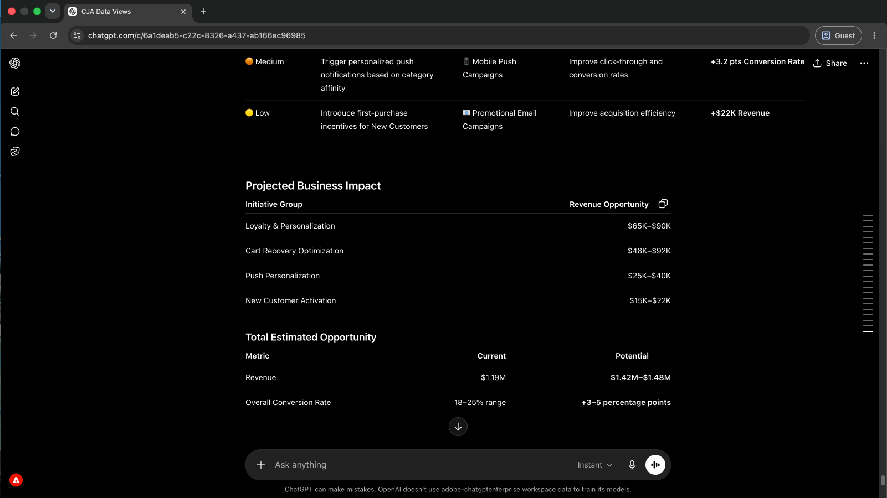
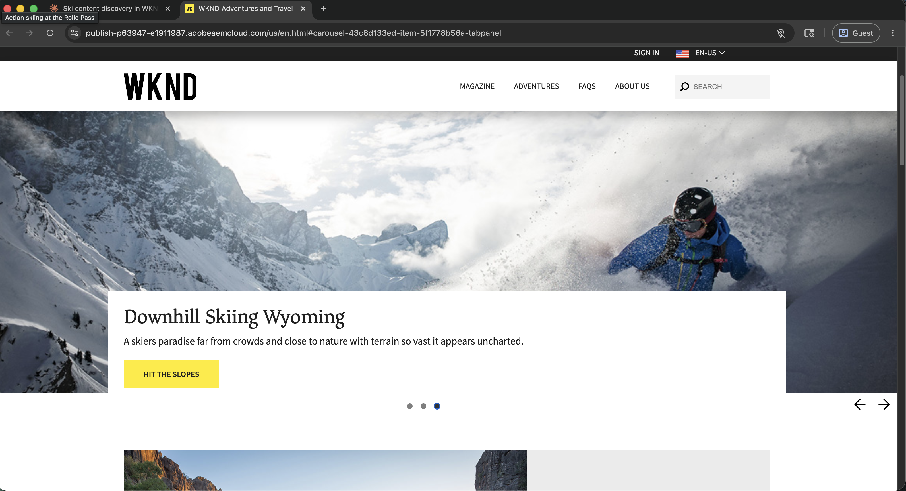

# MCP 伺服器

<!-- last-modified: 2026-09-16 -->

Adobe MCP伺服器可讓任何相容的AI使用者端直接受控存取Adobe資料和工作流程。 連線一次，您就可以查詢行銷活動績效、啟用對象、檢閱歷程、管理內容等，這一切都以淺顯的語言完成，無需離開您的AI環境。 由於MCP伺服器位於AI使用者端和Adobe的基本系統之間，因此您可以在組織的存取控制和資料控管保持有效的同時，獲得自然語言的靈活性。

Adobe MCP伺服器遵循開啟的[模型內容通訊協定](https://modelcontextprotocol.io/docs/getting-started/intro)標準。 任何與MCP相容的AI使用者端都會連線至任何Adobe MCP伺服器。

## CX Enterprise MCP 伺服器 {#cx-enterprise-mcp-servers}

>[!CONTEXTUALHELP]
>id="cx-enterprise-agentic-tools_mcp_servers_cx-enterprise"
>title="CX Enterprise Coworker"
>abstract="以簡單的語言詢問、分析您的CX Enterprise應用程式並採取行動，不需要伺服器設定。 對於具有自己MCP伺服器的個別應用程式，請直接連線。"
>additional-url="https://experienceleague.adobe.com/zh-hant/docs/cx-enterprise-coworker/content/home" text="CX Enterprise Coworker檔案"


**使用CX Enterprise應用程式的最快方式是CX Enterprise Coworker。** 它可連線至您的CX Enterprise應用程式，不需要伺服器設定、不需要註冊端點，也不需要AI使用者端設定。 [試用CX Enterprise Coworker](https://experienceleague.adobe.com/zh-hant/docs/cx-enterprise-coworker/content/home)

如果您想要將自己的AI使用者端直接連線到特定的Adobe應用程式，則數個應用程式也會有自己的MCP伺服器。

| MCP伺服器 | 端點 | 您可以做什麼 | 亦透過CX Enterprise Coworker |
| --- | --- | --- | --- |
| [Adobe Journey Optimizer](https://experienceleague.adobe.com/en/docs/experience-cloud-ai/experience-cloud-ai/mcp/mcp-product-tools/ajo-mcp) | `https://ajo-mcp.adobe.io/mcp` | 檢閱歷程、行銷活動和管道設定 | 是 |
| [Customer Journey Analytics](https://experienceleague.adobe.com/en/docs/experience-cloud-ai/experience-cloud-ai/mcp/mcp-product-tools/cja-mcp) | `https://cja-mcp.adobe.io/mcp` | 查詢報表、探索資料檢視及製作工作區 | 是 |
| [Adobe Analytics](https://experienceleague.adobe.com/en/docs/experience-cloud-ai/experience-cloud-ai/mcp/mcp-product-tools/analytics-mcp) | `https://aa-mcp.adobe.io/mcp` | 報表套裝探索、區段製作和工作區建立 | 是 |
| [Adobe Target](https://experienceleague.adobe.com/en/docs/target/using/mcp/target-mcp) | `https://targetmcp.adobe.io/mcp` | 檢閱活動、選件、對象、mbox、效能報表和預覽URL （公開測試版：工具為唯讀，撰寫工具已規劃為一般可用性） | 是 |
| [Real-Time CDP](https://experienceleague.adobe.com/en/docs/experience-platform/rtcdp/intro/rtcdp-mcp) | `https://rtcdp-mcp.adobe.io/mcp` | 搜尋對象、目的地、來源和流量執行；檢查身分名稱空間和合併原則（公開測試版：需要允許清單，所有工具均為唯讀） | 是 |
| [AEM MCP伺服器](https://experienceleague.adobe.com/zh-hant/docs/experience-manager-learn/cloud-service/ai/mcp-servers/overview) | `https://mcp.adobeaemcloud.com/adobe/mcp/aem` | 管理頁面、內容片段、資產和啟動；根據品牌准則和合規性規則評估內容和影像 | 是 |
| [AEM Cloud Manager](https://experienceleague.adobe.com/zh-hant/docs/experience-manager-learn/cloud-service/ai/mcp-servers/cloud-manager) | `https://mcp.adobeaemcloud.com/adobe/mcp/cloudmanager` | 管理計畫、環境、管道和存放庫 | 否 |
| Adobe Marketing Agent | `https://aep-ai-ama.adobe.io/mcp` | 跨AEP應用程式協調受眾分析、AEP診斷和AJO B2B歷程建置 | 否 |
| [Adobe Workfront](https://experienceleague.adobe.com/en/docs/workfront/using/basics/workfront-mcp-server/workfront-mcp-server-overview) | `https://mcp.prod.us-west-2.aws.wfk8s.com/mcp/v1/workfront` | 管理工作、專案、規劃記錄、見解和內容核准 | 否 |
| [Marketo Engage](https://experienceleague.adobe.com/en/docs/marketo-developer/marketo/mcp-server) | `https://marketo-mcp.adobe.io/mcp` | 管理表單、智慧行銷活動、銷售機會、清單、方案、電子郵件和大量作業 | 是 |
| Adobe Experience Platform | 透過[CX Enterprise Coworker](https://experienceleague.adobe.com/zh-hant/docs/cx-enterprise-coworker/content/home) | 資料集探索、結構瀏覽和沙箱管理 | 不適用 |
| Campaign Classic | 透過[CX Enterprise Coworker](https://experienceleague.adobe.com/zh-hant/docs/cx-enterprise-coworker/content/home) | 行銷活動執行個體探索、結構描述瀏覽、查詢執行、工作流程控制和SOAP/JS執行 | 不適用 |
| 實驗 | 透過[CX Enterprise Coworker](https://experienceleague.adobe.com/zh-hant/docs/cx-enterprise-coworker/content/home) | A/B、MVT和MAB實驗報告、量度、見解、機會和樣本大小計畫 | 不適用 |
| GenStudio for Performance Marketing | 透過[CX Enterprise Coworker](https://experienceleague.adobe.com/zh-hant/docs/cx-enterprise-coworker/content/home) | 存取廣告績效資料和創意見解 | 不適用 |
| Adobe Journey Optimizer B2B edition | 透過[CX Enterprise Coworker](https://experienceleague.adobe.com/zh-hant/docs/cx-enterprise-coworker/content/home) | 管理B2B歷程、帳戶計畫、購買群組及個人化 | 不適用 |

>[!NOTE]
>
>存取每部MCP伺服器取決於貴組織對該應用程式的許可權，以及使用者在該應用程式中的許可權。 最後五個資料列尚未有自己的MCP伺服器可供直接連線。 立即使用CX Enterprise Coworker與他們聯絡。

## 連線至您的AI使用者端

大部分的Adobe MCP伺服器都使用OAuth搭配Adobe Identity Management服務(IMS)。 出現提示時，請選取正確的IMS組織。 選擇錯誤是驗證錯誤最常見的來源。


如果您使用CX Enterprise Coworker，這些連線會自動發生。 以下不適用於您。 以下步驟是將您自己的AI使用者端直接連線到Adobe MCP伺服器，並使用AEM MCP伺服器端點作為範例。 相同的程式適用於任何Adobe MCP伺服器：交換您要連線的伺服器端點URL。

>[!BEGINTABS]

>[!TAB CX Enterprise Coworker]

CX Enterprise Coworker已包含許多MCP功能。 沒有要新增的伺服器、要註冊的端點，以及要設定的AI使用者端。 登入CX Enterprise Coworker即可使用。

完整檔案： [CX Enterprise Coworker檔案](https://experienceleague.adobe.com/zh-hant/docs/cx-enterprise-coworker/content/home)

>[!TAB Claude.ai]

### 使用Managed聯結器

移至[Adobe AI登入](https://developer.adobe.com/ai-registry/?type=connector)並搜尋您的Adobe應用程式。 如果列出了Claude聯結器（例如[Adobe Experience Manager聯結器](https://developer.adobe.com/ai-registry/#/connectors/adobe-experience-manager-connector)），請依照其設定指示操作，而非依照下列步驟操作。

### 使用自訂聯結器連線

Claude.ai透過帳戶設定中的自訂聯結器支援遠端MCP伺服器。

1. 移至&#x200B;**設定>整合**。
2. 按一下&#x200B;**新增自訂聯結器**。
3. 輸入伺服器端點作為URL （例如，AEM MCP伺服器為`https://mcp.adobeaemcloud.com/adobe/mcp/aem`）以及您選擇的顯示名稱。
4. 按一下「**連線**」並使用您的Adobe ID登入。 選取正確的IMS組織。

完整設定： [Claude.ai自訂聯結器檔案](https://support.claude.com/en/articles/11175166-get-started-with-custom-connectors-using-remote-mcp)

>[!TAB 克勞德程式碼]

### 使用CLI

執行`claude mcp add`以註冊Adobe MCP伺服器。 將伺服器名稱和URL取代為您要連線的伺服器值。 此範例使用AEM MCP伺服器：

```bash
claude mcp add --transport http adobe-aem https://mcp.adobeaemcloud.com/adobe/mcp/aem
```

### 編輯您的設定檔案

將伺服器新增至專案根目錄（專案層級）中的`~/.claude.json` （全域）或`.mcp.json`。 將索引鍵和URL取代為您要連線的伺服器值：

```json
{
  "mcpServers": {
    "adobe-aem": {
      "type": "http",
      "url": "https://mcp.adobeaemcloud.com/adobe/mcp/aem"
    }
  }
}
```

Adobe MCP伺服器使用OAuth。 當您第一次呼叫工具時，克勞德程式碼會提示您使用Adobe ID進行驗證。 出現提示時，請選取正確的IMS組織。

完整設定： [克勞德程式碼MCP檔案](https://docs.anthropic.com/en/docs/claude-code/mcp)

>[!TAB 游標]

將Adobe MCP伺服器新增至您的Cursor `mcp.json`設定檔，然後透過&#x200B;**設定> MCP**&#x200B;連線。 將索引鍵和URL取代為您要連線的伺服器值。 此範例使用AEM MCP伺服器：

- **全域（所有專案）：** `~/.cursor/mcp.json`
- **專案層級：** `.cursor/mcp.json`在您的專案根目錄中

```json
{
  "mcpServers": {
    "adobe-aem": {
      "type": "http",
      "url": "https://mcp.adobeaemcloud.com/adobe/mcp/aem"
    }
  }
}
```

新增後，MCP伺服器會出現在游標設定中的&#x200B;**已安裝MCP伺服器**&#x200B;下。 選取任何顯示&#x200B;**需要驗證**&#x200B;且使用您的Adobe ID登入的伺服器旁的&#x200B;**連線**。 選取可存取應用程式的IMS組織。


完整設定： [Cursor MCP檔案](https://cursor.com/docs/mcp)

>[!TAB ChatGPT]

### 使用Managed聯結器

移至[Adobe AI登入](https://developer.adobe.com/ai-registry/?type=connector)並搜尋您的Adobe應用程式。 如果列出ChatGPT聯結器，請按照其設定指示操作，而不是下面的步驟。

### 使用遠端MCP伺服器連線

請要求ChatGPT管理員為您的組織新增MCP伺服器。 這可讓每位使用者無需進行下列設定即可連線。

如果管理員無法新增該連線，或您只想為帳戶建立連線，請按照下列步驟操作。

**一次性設定：**&#x200B;開啟開發人員模式，然後才能註冊自訂MCP URL。

1. 移至&#x200B;**設定>安全性並登入**。
2. 開啟&#x200B;**開發人員模式**。

**新增伺服器：**

1. 移至&#x200B;**設定>外掛程式>瀏覽外掛程式**。
2. 選取&#x200B;**+**&#x200B;以新增外掛程式。
3. 輸入名稱，例如`AEM Content AI`或`Adobe Journey Optimizer`。
4. 輸入說明。
5. 選取&#x200B;**伺服器URL**。
6. 在&#x200B;**連線**&#x200B;下，輸入完整的Adobe MCP URL。 例如，`https://mcp.adobeaemcloud.com/adobe/mcp/aem`用於AEM，或`https://ajo-mcp.adobe.io/mcp`用於Adobe Journey Optimizer。
7. 將&#x200B;**驗證**&#x200B;設定為&#x200B;**OAuth**。
8. 閱讀並接受服務條款。
9. 選取「**建立**」。
10. 使用Adobe帳戶登入，該帳戶可存取MCP伺服器所連線的CX Enterprise應用程式。

完整設定： [ChatGPT MCP檔案](https://developers.openai.com/api/docs/guides/tools-connectors-mcp)

>[!TAB OpenAI程式碼CLI]

OpenAI Codex CLI透過TOML組態支援遠端MCP伺服器。

**設定檔位置：**

- **使用者層級（所有專案）：** `~/.codex/config.toml`
- 專案根目錄中的&#x200B;**專案範圍：** `.codex/config.toml`

將區段名稱和URL取代為您要連線的伺服器值。 此範例使用AEM MCP伺服器：

```toml
[mcp_servers.adobe-aem]
url = "https://mcp.adobeaemcloud.com/adobe/mcp/aem"
enabled = true
```

Adobe MCP伺服器使用OAuth。 Codex CLI會在第一次使用時自動處理OAuth流程。 出現提示時，請選取正確的IMS組織。

完整設定： [OpenAI Codex CLI MCP檔案](https://developers.openai.com/codex/mcp)

>[!TAB Copilot Studio]

Microsoft Copilot Studio使用MCP上線精靈連線到遠端MCP伺服器，精靈會自動建立Power Platform自訂聯結器。

1. 在Copilot Studio中開啟代理程式。
2. 移至&#x200B;**工具**&#x200B;頁面。
3. 選取&#x200B;**新增工具>新增工具>模型內容通訊協定**。
4. 在MCP上線精靈中，輸入伺服器詳細資訊。 例如，對於AEM MCP伺服器：
   - **伺服器名稱：** `AEM`
   - **伺服器URL：** `https://mcp.adobeaemcloud.com/adobe/mcp/aem`
5. 將驗證設定為&#x200B;**OAuth 2.0**，並使用您的Adobe IMS授權和權杖URL進行設定。
6. 選取&#x200B;**建立**，然後選取&#x200B;**新增至代理程式**。

>[!NOTE]
>
>Copilot Studio中的MCP伺服器連線會通過Power Platform。 您組織的資料遺失預防(DLP)政策在此適用。

完整設定： [Copilot Studio MCP檔案](https://learn.microsoft.com/microsoft-copilot-studio/mcp-add-existing-server-to-agent)

>[!ENDTABS]

## MCP伺服器正在執行中

請參閱Adobe MCP伺服器解決實際業務問題。 每個逐步解說都會從真正的操作挑戰開始，並展示AI使用者端如何以簡單的語言解決它，而不需要切換工具或編寫程式碼。

<!--
CARDS

* ../use-cases/analyze-campaign-performance.md
  {title = Campaign insights without reports}
  {description = Ask performance questions in plain language and get answers from Customer Journey Analytics, without building a single report.}
  {cta = Surface campaign insights}

* ../use-cases/query-audiences.md
  {title = Audience activation at a glance}
  {description = See which audiences are live, where they are flowing, and whether destinations are healthy, without navigating Real-Time CDP.}
  {cta = Check audience activation}

* ../use-cases/manage-ajo-journeys.md
  {title = Catch journey issues early}
  {description = Monitor active journeys and surface operational issues before they reach your audience.}
  {cta = Monitor your journeys}

* ../use-cases/manage-aem-content.md
  {title = Ship content updates faster}
  {description = Find, update, and publish AEM pages and content fragments faster, without switching to the AEM interface.}
  {cta = Ship content faster}

* ../use-cases/optimize-content-with-performance-data.md
  {title = Close content performance gaps}
  {description = Surface conversion gaps in CJA, trace them to underperforming content in AEM, and apply the fix in a single AI session.}
  {cta = Close performance gaps}
-->

<!-- START CARDS HTML - DO NOT MODIFY BY HAND -->
<div class="columns">
    <div class="column is-half-tablet is-half-desktop is-one-third-widescreen" aria-label="Campaign insights without reports">
        <div class="card" style="height: 100%; display: flex; flex-direction: column; height: 100%;">
            <div class="card-image">
                <figure class="image x-is-16by9">
                    <a href="../use-cases/analyze-campaign-performance.md" title="不含報表的行銷活動深入分析">
                        
                    </a>
                </figure>
            </div>
            <div class="card-content is-padded-small" style="display: flex; flex-direction: column; flex-grow: 1; justify-content: space-between;">
                <div class="top-card-content">
                    <p class="headline is-size-6 has-text-weight-bold">
                        <a href="../use-cases/analyze-campaign-performance.md" title="不含報表的行銷活動深入分析">沒有報表的行銷活動深入分析</a>
                    </p>
                    <p class="is-size-6">以簡單的語言提出效能問題，並從Customer Journey Analytics獲得答案，而不需要建立單一報表。</p>
                </div>
                <a href="../use-cases/analyze-campaign-performance.md" class="spectrum-Button spectrum-Button--outline spectrum-Button--primary spectrum-Button--sizeM" style="align-self: flex-start; margin-top: 1rem;">
                    <span class="spectrum-Button-label has-no-wrap has-text-weight-bold">表面行銷活動深入分析</span>
                </a>
            </div>
        </div>
    </div>
    <div class="column is-half-tablet is-half-desktop is-one-third-widescreen" aria-label="Audience activation at a glance">
        <div class="card" style="height: 100%; display: flex; flex-direction: column; height: 100%;">
            <div class="card-image">
                <figure class="image x-is-16by9">
                    <a href="../use-cases/query-audiences.md" title="對象啟用總覽">
                        
                    </a>
                </figure>
            </div>
            <div class="card-content is-padded-small" style="display: flex; flex-direction: column; flex-grow: 1; justify-content: space-between;">
                <div class="top-card-content">
                    <p class="headline is-size-6 has-text-weight-bold">
                        <a href="../use-cases/query-audiences.md" title="對象啟用總覽">對象啟用一覽</a>
                    </p>
                    <p class="is-size-6">無須導覽Real-Time CDP，即可檢視哪些對象已上線、流量在哪裡，以及目的地是否健康。</p>
                </div>
                <a href="../use-cases/query-audiences.md" class="spectrum-Button spectrum-Button--outline spectrum-Button--primary spectrum-Button--sizeM" style="align-self: flex-start; margin-top: 1rem;">
                    <span class="spectrum-Button-label has-no-wrap has-text-weight-bold">檢查對象啟用</span>
                </a>
            </div>
        </div>
    </div>
    <div class="column is-half-tablet is-half-desktop is-one-third-widescreen" aria-label="Catch journey issues early">
        <div class="card" style="height: 100%; display: flex; flex-direction: column; height: 100%;">
            <div class="card-image">
                <figure class="image x-is-16by9">
                    <a href="../use-cases/manage-ajo-journeys.md" title="及早發現歷程問題">
                        
                    </a>
                </figure>
            </div>
            <div class="card-content is-padded-small" style="display: flex; flex-direction: column; flex-grow: 1; justify-content: space-between;">
                <div class="top-card-content">
                    <p class="headline is-size-6 has-text-weight-bold">
                        <a href="../use-cases/manage-ajo-journeys.md" title="及早發現歷程問題">提早發現歷程問題</a>
                    </p>
                    <p class="is-size-6">在作用中歷程和表面操作問題觸及您的受眾之前，對其進行監視。</p>
                </div>
                <a href="../use-cases/manage-ajo-journeys.md" class="spectrum-Button spectrum-Button--outline spectrum-Button--primary spectrum-Button--sizeM" style="align-self: flex-start; margin-top: 1rem;">
                    <span class="spectrum-Button-label has-no-wrap has-text-weight-bold">監視您的歷程</span>
                </a>
            </div>
        </div>
    </div>
    <div class="column is-half-tablet is-half-desktop is-one-third-widescreen" aria-label="Ship content updates faster">
        <div class="card" style="height: 100%; display: flex; flex-direction: column; height: 100%;">
            <div class="card-image">
                <figure class="image x-is-16by9">
                    <a href="../use-cases/manage-aem-content.md" title="加快傳送內容更新的速度">
                        
                    </a>
                </figure>
            </div>
            <div class="card-content is-padded-small" style="display: flex; flex-direction: column; flex-grow: 1; justify-content: space-between;">
                <div class="top-card-content">
                    <p class="headline is-size-6 has-text-weight-bold">
                        <a href="../use-cases/manage-aem-content.md" title="加快傳送內容更新的速度">快送出內容更新</a>
                    </p>
                    <p class="is-size-6">無需切換至AEM介面，即可更快速地尋找、更新和發佈AEM頁面和內容片段。</p>
                </div>
                <a href="../use-cases/manage-aem-content.md" class="spectrum-Button spectrum-Button--outline spectrum-Button--primary spectrum-Button--sizeM" style="align-self: flex-start; margin-top: 1rem;">
                    <span class="spectrum-Button-label has-no-wrap has-text-weight-bold">快送內容</span>
                </a>
            </div>
        </div>
    </div>
    <div class="column is-half-tablet is-half-desktop is-one-third-widescreen" aria-label="Close content performance gaps">
        <div class="card" style="height: 100%; display: flex; flex-direction: column; height: 100%;">
            <div class="card-image">
                <figure class="image x-is-16by9">
                    <a href="../use-cases/optimize-content-with-performance-data.md" title="縮小內容效能差距">
                        
                    </a>
                </figure>
            </div>
            <div class="card-content is-padded-small" style="display: flex; flex-direction: column; flex-grow: 1; justify-content: space-between;">
                <div class="top-card-content">
                    <p class="headline is-size-6 has-text-weight-bold">
                        <a href="../use-cases/optimize-content-with-performance-data.md" title="縮小內容效能差距">關閉內容效能差距</a>
                    </p>
                    <p class="is-size-6">在CJA中顯示轉換間隙，將其追蹤至AEM中表現缺佳的內容，並在單一AI工作階段中套用修正。</p>
                </div>
                <a href="../use-cases/optimize-content-with-performance-data.md" class="spectrum-Button spectrum-Button--outline spectrum-Button--primary spectrum-Button--sizeM" style="align-self: flex-start; margin-top: 1rem;">
                    <span class="spectrum-Button-label has-no-wrap has-text-weight-bold">縮小效能差距</span>
                </a>
            </div>
        </div>
    </div>
</div>
<!-- END CARDS HTML - DO NOT MODIFY BY HAND -->

## 需要更多協助嗎？

MCP連線涉及驗證、組織選擇和應用程式層級的許可權。 如果某些專案未按預期運作，這些步驟會涵蓋最常見的原因。

+++切換Adobe組織

如果您的Adobe使用者屬於多個IMS組織，而您看到錯誤的工具或資料，請中斷MCP伺服器連線，在瀏覽器中登出Adobe工作階段，然後重新連線。 登入時，系統會提示您選擇組織。

Adobe MCP伺服器一次只能驗證一個IMS組織，即使您的使用者帳戶有權存取多個組織亦然。

+++

+++指定沙箱、報告套裝、環境或其他工作階段資源

有些Adobe MCP伺服器會要求您先指定資源，才能傳回結果。 根據應用程式的不同，這可能是沙箱、程式、環境、報表套裝或資料檢視。

如果您不確定您有權存取哪些資源，請向AI使用者端詢問。 例如：「列出可用的沙箱」或「我有權存取哪些報表套裝？」 Adobe MCP伺服器通常會傳回使用者可用的完整資源清單。

設定工作階段資源後，您可以隨時通知AI使用者端要使用哪個工作階段資源，以進行切換。

+++

+++許可權和存取錯誤

AI使用者端使用OAuth來代表您的Adobe使用者帳戶行事。 當您登入Adobe應用程式時，所套用的許可權和存取控制也會在您使用MCP伺服器時套用。

如果動作失敗或未傳回任何結果，請檢查您的使用者是否在Adobe Admin Console和相關CX Enterprise應用程式中擁有所需許可權。 如果您需要調整存取許可權，請聯絡您的Adobe系統管理員。

+++

+++在遺失工作階段後重新驗證

Adobe MCP伺服器會使用OAuth驗證您的Adobe使用者帳戶。 如果驗證狀態遺失，在您重新驗證之前，將不會成功進行進一步的工具呼叫。

若要重新驗證：開啟您的AI使用者端的MCP伺服器設定，選取Adobe MCP伺服器專案，然後重新連線。 系統會提示您再次使用Adobe ID登入。

+++
