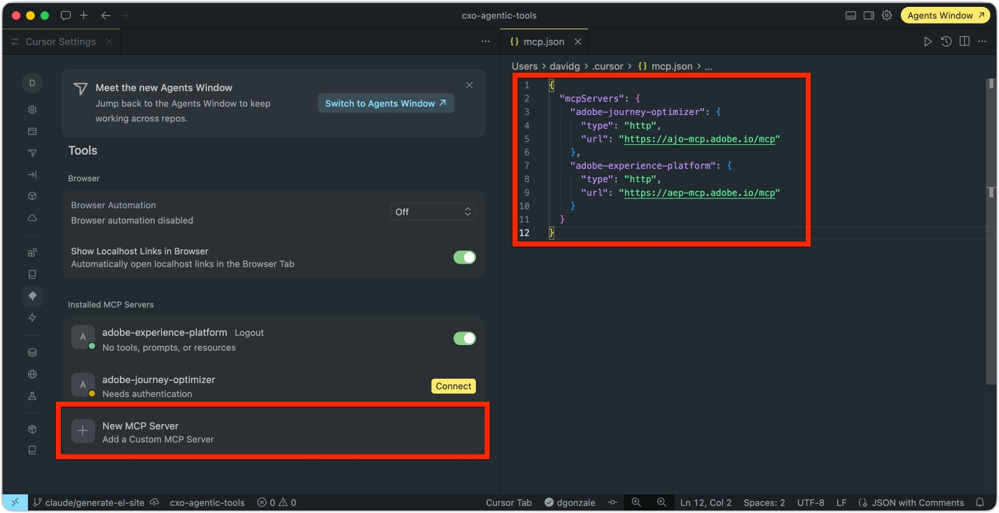
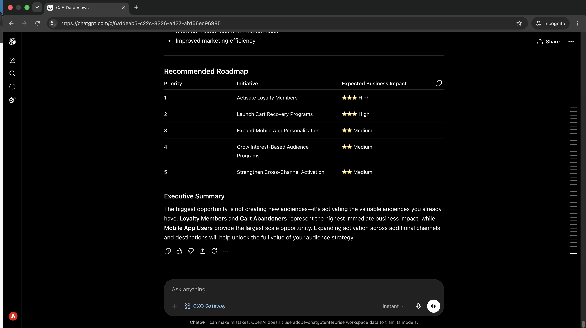
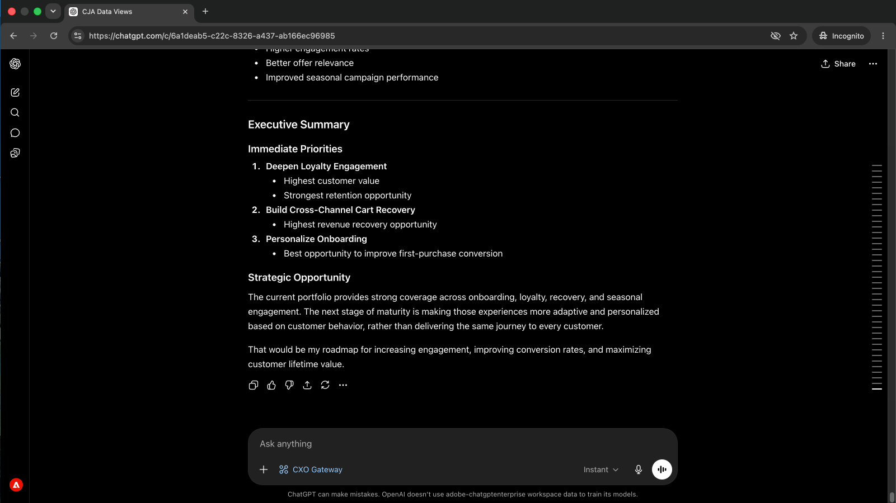
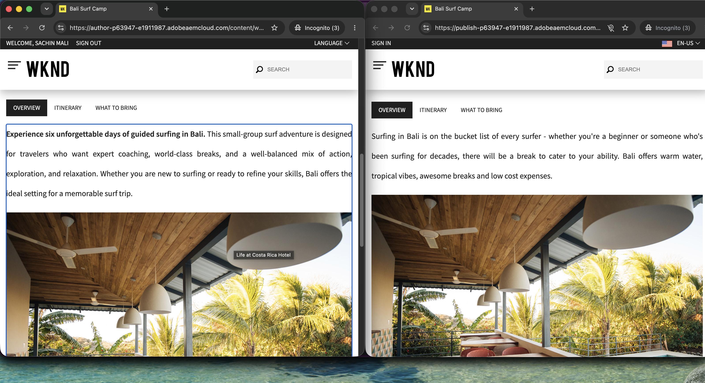

# MCP伺服器

<!-- last-modified: 2026-06-09 -->

>[!VIDEO](https://video.tv.adobe.com/v/3491333/?captions=chi_hant&learn=on&enablevpops)

Adobe CX Enterprise MCP伺服器可讓任何相容的AI使用者端直接受控存取Adobe資料和工作流程。 連線一次，您就可以查詢行銷活動績效、啟用對象、檢閱歷程、管理內容等，這一切都以淺顯的語言完成，無需離開您的AI環境。 由於MCP伺服器位於AI使用者端和Adobe的基本系統之間，因此您可以在組織的存取控制和資料控管保持有效的同時，獲得自然語言的靈活性。

Adobe MCP伺服器遵循開啟的[模型內容通訊協定](https://modelcontextprotocol.io/docs/getting-started/intro)標準。 任何與MCP相容的AI使用者端都會連線至任何Adobe MCP伺服器。

## CX Enterprise MCP伺服器


選取應用程式以檢視端點和功能。

>[!BEGINTABS]

>[!TAB CX Enterprise MCP]

**一個端點。 多個CX Enterprise應用程式。**

連線一次，您的AI使用者端即可根據貴組織的授權存取CX Enterprise應用程式。 若要啟用您的組織，請傳送電子郵件至[cxo-mcp-feedback@adobe.com](mailto:cxo-mcp-feedback@adobe.com)要求存取權。

```
https://cx-enterprise.adobe.io/mcp
```

| CX Enterprise應用程式 | 您可以做什麼 |
| --- | --- |
| Adobe Analytics | 報表套裝探索、區段製作和工作區建立 |
| Adobe Experience Platform | 資料集探索、結構瀏覽和沙箱管理 |
| Adobe Journey Optimizer | 檢閱歷程、行銷活動和管道設定 |
| Adobe Journey Optimizer B2B edition | 管理B2B歷程、帳戶計畫、購買群組及個人化 |
| Customer Journey Analytics | 查詢報表、探索資料檢視及製作工作區 |
| Real-Time CDP | 檢查對象啟用狀態、目的地健康狀況和資料流健康狀況 |

>[!NOTE]
>
>每個CX Enterprise應用程式的存取權取決於貴組織在Adobe Admin Console中的權益和使用者的許可權。 若要為您的組織啟用CX Enterprise MCP，請傳送電子郵件至[cxo-mcp-feedback@adobe.com](mailto:cxo-mcp-feedback@adobe.com)。

>[!TAB Experience Manager]

Adobe Experience Manager有多個MCP伺服器可供不同工作流程使用。

| MCP伺服器 | 端點 | 您可以做什麼 |
| --- | --- | --- |
| [AEM （程式碼模式）](https://experienceleague.adobe.com/zh-hant/docs/experience-manager-cloud-service/content/ai-in-aem/using-mcp-with-aem-as-a-cloud-service) | `https://mcp.adobeaemcloud.com/adobe/mcp/aem` | 透過自然語言查詢、讀取、寫入和刪除，直接REST API存取AEM |
| [AEM Cloud Manager](https://experienceleague.adobe.com/zh-hant/docs/experience-manager-learn/cloud-service/ai/mcp-servers/cloud-manager) | `https://mcp.adobeaemcloud.com/adobe/mcp/cloudmanager` | 管理計畫、環境、管道和存放庫 |
| [AEM內容](https://experienceleague.adobe.com/zh-hant/docs/experience-manager-cloud-service/content/ai-in-aem/using-mcp-with-aem-as-a-cloud-service) | `https://mcp.adobeaemcloud.com/adobe/mcp/content` | 管理頁面、內容片段、資產和啟動 |
| [AEM內容（唯讀）](https://experienceleague.adobe.com/zh-hant/docs/experience-manager-cloud-service/content/ai-in-aem/using-mcp-with-aem-as-a-cloud-service) | `https://mcp.adobeaemcloud.com/adobe/mcp/content-readonly` | 探索和查詢頁面、內容片段以及沒有寫入許可權的啟動 |
| AEM檔案製作 | `https://mcp.adobeaemcloud.com/adobe/mcp/da` | 在檔案製作中管理檔案、版本記錄和媒體參考 |
| [AEM體驗控管](https://experienceleague.adobe.com/en/docs/experience-manager-learn/cloud-service/ai/mcp-servers/experience-governance-mcp-server) | `https://mcp.adobeaemcloud.com/adobe/mcp/experience-governance` | 根據品牌指引和法規遵循評估內容和影像 |
| [AEM Experience Production](https://experienceleague.adobe.com/zh-hant/docs/experience-manager-cloud-service/content/ai-in-aem/agents/brand-experience/experience-production/overview) | `https://mcp.adobeaemcloud.com/adobe/mcp/experience-production` | 使用AI驅動的內容簡介大規模轉換和建立AEM頁面 |

>[!NOTE]
>
>存取每個AEM環境取決於您組織的AEM Cloud Service許可權和您使用者在該環境中的許可權。

>[!TAB Experience Platform]

| MCP伺服器 | 端點 | 您可以做什麼 |
| --- | --- | --- |
| Adobe Marketing Agent | `https://aep-ai-ama.adobe.io/mcp` | 跨AEP應用程式協調受眾分析、AEP診斷和AJO B2B歷程建置 |

>[!NOTE]
>
>存取權取決於您組織的Adobe Experience Platform許可權和使用者的許可權。

>[!TAB Marketo Engage]

| MCP伺服器 | 端點 | 您可以做什麼 |
| --- | --- | --- |
| [Marketo Engage](https://experienceleague.adobe.com/zh-hant/docs/marketo-developer/marketo/mcp-server) | `https://marketo-mcp.adobe.io/mcp` | 管理方案、行銷活動、銷售機會、智慧清單、電子郵件和表單 |

>[!NOTE]
>
>Marketo Engage MCP使用Marketo原生服務憑證，而不是Adobe IMS。 如需驗證設定，請參閱[Marketo Engage MCP伺服器檔案](https://experienceleague.adobe.com/zh-hant/docs/marketo-developer/marketo/mcp-server)。 存取權取決於您的Marketo Engage訂閱和API使用者的許可權。

>[!TAB Target]

Adobe Target MCP處於公開測試版。 所有目前可用的工具都是唯讀的。 寫入工具已規劃為一般可用性。

| MCP伺服器 | 端點 | 您可以做什麼 |
| --- | --- | --- |
| [Adobe Target](https://experienceleague.adobe.com/zh-hant/docs/target/using/mcp/target-mcp) | `https://targetmcp.adobe.io/mcp` | 檢閱活動、選件、對象、mbox和效能報表 |

>[!NOTE]
>
>存取權取決於您的Adobe Target許可權和使用者的許可權。

>[!TAB Workfront]

| MCP伺服器 | 端點 | 您可以做什麼 |
| --- | --- | --- |
| Adobe Workfront | `https://mcp.prod.us-west-2.aws.wfk8s.com/mcp/v1/workfront` | 管理工作、專案、規劃記錄、見解和內容核准 |

>[!NOTE]
>
>存取權取決於您的Adobe Workfront授權和使用者的許可權。

>[!ENDTABS]

## 連線至您的AI使用者端

所有Adobe MCP伺服器都使用OAuth搭配Adobe Identity Management服務(IMS)。 出現提示時，請選取正確的IMS組織。 選擇錯誤是驗證錯誤最常見的來源。

在手動設定之前，請檢查[Adobe AI登入](https://developer.adobe.com/ai-registry/?type=connector)，以取得您的AI使用者端和Adobe應用程式的Managed聯結器。 受管理的聯結器會自動處理驗證。 如果您的使用者端和應用程式有可用的聯結器，請改用它，而不是下面的手動步驟。

以下步驟使用CX Enterprise MCP端點作為範例。 相同的程式適用於任何Adobe MCP伺服器 — 交換您要連線的伺服器端點URL。


>[!BEGINTABS]

>[!TAB Claude.ai]

### 使用Managed聯結器

移至[Adobe AI登入](https://developer.adobe.com/ai-registry/?type=connector)並搜尋您的Adobe應用程式。 如果列出了Claude聯結器（例如[Adobe Experience Manager聯結器](https://developer.adobe.com/ai-registry/#/connectors/adobe-experience-manager-connector)），請依照其設定指示操作，而非依照下列步驟操作。

### 使用自訂聯結器連線

Claude.ai透過帳戶設定中的自訂聯結器支援遠端MCP伺服器。

1. 移至&#x200B;**設定>整合**。
2. 按一下&#x200B;**新增自訂聯結器**。
3. 輸入伺服器端點作為URL （例如，CX Enterprise MCP為`https://cx-enterprise.adobe.io/mcp`）以及您選擇的顯示名稱。
4. 按一下「**連線**」並使用您的Adobe ID登入。 選取正確的IMS組織。

完整設定： [Claude.ai自訂聯結器檔案](https://support.claude.com/en/articles/11175166-get-started-with-custom-connectors-using-remote-mcp)

>[!TAB 克勞德程式碼]

### 使用CLI

執行`claude mcp add`以註冊Adobe MCP伺服器。 將伺服器名稱和URL取代為您要連線的伺服器值。 此範例使用CX Enterprise MCP：

```bash
claude mcp add --transport http adobe-cx-enterprise https://cx-enterprise.adobe.io/mcp
```

### 編輯您的設定檔案

將伺服器新增至專案根目錄（專案層級）中的`~/.claude.json` （全域）或`.mcp.json`。 將索引鍵和URL取代為您要連線的伺服器值：

```json
{
  "mcpServers": {
    "adobe-cx-enterprise": {
      "type": "http",
      "url": "https://cx-enterprise.adobe.io/mcp"
    }
  }
}
```

Adobe MCP伺服器使用OAuth。 當您第一次呼叫工具時，克勞德程式碼會提示您使用Adobe ID進行驗證。 出現提示時，請選取正確的IMS組織。

完整設定： [克勞德程式碼MCP檔案](https://docs.anthropic.com/en/docs/claude-code/mcp)

>[!TAB 游標]

將Adobe MCP伺服器新增至您的Cursor `mcp.json`設定檔，然後透過&#x200B;**設定> MCP**&#x200B;連線。 將索引鍵和URL取代為您要連線的伺服器值。 此範例使用CX Enterprise MCP：

- **全域（所有專案）：** `~/.cursor/mcp.json`
- **專案層級：** `.cursor/mcp.json`在您的專案根目錄中

```json
{
  "mcpServers": {
    "adobe-cx-enterprise": {
      "type": "http",
      "url": "https://cx-enterprise.adobe.io/mcp"
    }
  }
}
```

新增後，MCP伺服器會出現在游標設定中的&#x200B;**已安裝MCP伺服器**&#x200B;下。 選取任何顯示&#x200B;**需要驗證**&#x200B;且使用您的Adobe ID登入的伺服器旁的&#x200B;**連線**。 選取可存取應用程式的IMS組織。



完整設定： [Cursor MCP檔案](https://cursor.com/docs/mcp)

>[!TAB ChatGPT]

### 使用Managed聯結器

移至[Adobe AI登入](https://developer.adobe.com/ai-registry/?type=connector)並搜尋您的Adobe應用程式。 如果列出ChatGPT聯結器，請按照其設定指示操作，而不是下面的步驟。

### 使用遠端MCP伺服器連線

ChatGPT透過Pro、Plus、Business、Enterprise和Education計畫提供的[開發人員模式](https://developers.openai.com/api/docs/guides/developer-mode)支援遠端MCP伺服器。

1. 在&#x200B;**ChatGPT設定**&#x200B;中啟用開發人員模式。
2. 移至&#x200B;**設定>整合**。
3. 按一下&#x200B;**新增自訂聯結器**&#x200B;並選擇&#x200B;**遠端MCP伺服器**。
4. 輸入伺服器端點作為URL （例如，CX Enterprise MCP為`https://cx-enterprise.adobe.io/mcp`）以及您選擇的顯示名稱。
5. 將驗證設定為&#x200B;**OAuth**。
6. 按一下「**連線**」並使用您的Adobe ID登入。 選取正確的IMS組織。

完整設定： [ChatGPT MCP檔案](https://developers.openai.com/api/docs/guides/tools-connectors-mcp)

>[!TAB OpenAI程式碼CLI]

OpenAI Codex CLI透過TOML組態支援遠端MCP伺服器。

**設定檔位置：**

- **使用者層級（所有專案）：** `~/.codex/config.toml`
- 專案根目錄中的&#x200B;**專案範圍：** `.codex/config.toml`

將區段名稱和URL取代為您要連線的伺服器值。 此範例使用CX Enterprise MCP：

```toml
[mcp_servers.adobe-cx-enterprise]
url = "https://cx-enterprise.adobe.io/mcp"
enabled = true
```

Adobe MCP伺服器使用OAuth。 Codex CLI會在第一次使用時自動處理OAuth流程。 出現提示時，請選取正確的IMS組織。

完整設定： [OpenAI Codex CLI MCP檔案](https://developers.openai.com/codex/mcp)

>[!TAB Copilot Studio]

Microsoft Copilot Studio使用MCP上線精靈連線到遠端MCP伺服器，精靈會自動建立Power Platform自訂聯結器。

1. 在Copilot Studio中開啟代理程式。
2. 移至&#x200B;**工具**&#x200B;頁面。
3. 選取&#x200B;**新增工具>新增工具>模型內容通訊協定**。
4. 在MCP上線精靈中，輸入伺服器詳細資訊 — 例如CX Enterprise MCP：
   - **伺服器名稱：** `Adobe CX Enterprise`
   - **伺服器URL：** `https://cx-enterprise.adobe.io/mcp`
5. 將驗證設定為&#x200B;**OAuth 2.0**，並使用您的Adobe IMS授權和權杖URL進行設定。
6. 選取&#x200B;**建立**，然後選取&#x200B;**新增至代理程式**。

>[!NOTE]
>
>Copilot Studio中的MCP伺服器連線會通過Power Platform。 您組織的資料遺失預防(DLP)政策在此適用。

完整設定： [Copilot Studio MCP檔案](https://learn.microsoft.com/microsoft-copilot-studio/mcp-add-existing-server-to-agent)

>[!ENDTABS]

## 執行中的代理工具

請參閱套用至實際業務工作流程的Adobe CX Enterprise MCP伺服器。

<!--
CARDS

* ../use-cases/analyze-campaign-performance.md
  {title = Analyze campaign performance}
  {description = Use CX Enterprise MCP to surface Customer Journey Analytics metrics and insights from any AI client.}
  {cta = Start walkthrough}

* ../use-cases/query-audiences.md
  {title = Query audiences}
  {description = Use CX Enterprise MCP to query Real-Time CDP audience and destination data using plain language prompts.}
  {cta = Start walkthrough}

* ../use-cases/manage-ajo-journeys.md
  {title = Review AJO journeys}
  {description = Use CX Enterprise MCP to access AJO journeys, campaign status, and journey conditions from your AI client.}
  {cta = Start walkthrough}

* ../use-cases/manage-aem-content.md
  {title = Manage AEM content with AI}
  {description = Discover, update, and publish pages and content fragments in AEM using natural language.}
  {cta = Start walkthrough}

* ../use-cases/optimize-content-with-performance-data.md
  {title = Optimize content based on performance data}
  {description = Combine CX Enterprise MCP and AEM Content MCP Server to find underperforming content and update it in one session.}
  {cta = Start walkthrough}
-->

<!-- START CARDS HTML - DO NOT MODIFY BY HAND -->
<div class="columns">
    <div class="column is-half-tablet is-half-desktop is-one-third-widescreen" aria-label="Analyze campaign performance">
        <div class="card" style="height: 100%; display: flex; flex-direction: column; height: 100%;">
            <div class="card-image">
                <figure class="image x-is-16by9">
                    <a href="../use-cases/analyze-campaign-performance.md" title="分析行銷活動績效" target="_blank" rel="referrer">
                        
                    </a>
                </figure>
            </div>
            <div class="card-content is-padded-small" style="display: flex; flex-direction: column; flex-grow: 1; justify-content: space-between;">
                <div class="top-card-content">
                    <p class="headline is-size-6 has-text-weight-bold">
                        <a href="../use-cases/analyze-campaign-performance.md" target="_blank" rel="referrer" title="分析行銷活動績效">分析行銷活動績效</a>
                    </p>
                    <p class="is-size-6">使用CX Enterprise MCP來呈現任何AI使用者端的Customer Journey Analytics量度和深入分析。</p>
                </div>
                <a href="../use-cases/analyze-campaign-performance.md" target="_blank" rel="referrer" class="spectrum-Button spectrum-Button--outline spectrum-Button--primary spectrum-Button--sizeM" style="align-self: flex-start; margin-top: 1rem;">
                    <span class="spectrum-Button-label has-no-wrap has-text-weight-bold">開始逐步解說</span>
                </a>
            </div>
        </div>
    </div>
    <div class="column is-half-tablet is-half-desktop is-one-third-widescreen" aria-label="Query audiences">
        <div class="card" style="height: 100%; display: flex; flex-direction: column; height: 100%;">
            <div class="card-image">
                <figure class="image x-is-16by9">
                    <a href="../use-cases/query-audiences.md" title="查詢對象" target="_blank" rel="referrer">
                        
                    </a>
                </figure>
            </div>
            <div class="card-content is-padded-small" style="display: flex; flex-direction: column; flex-grow: 1; justify-content: space-between;">
                <div class="top-card-content">
                    <p class="headline is-size-6 has-text-weight-bold">
                        <a href="../use-cases/query-audiences.md" target="_blank" rel="referrer" title="查詢對象">查詢對象</a>
                    </p>
                    <p class="is-size-6">使用CX Enterprise MCP ，以純語言提示查詢Real-Time CDP對象和目的地資料。</p>
                </div>
                <a href="../use-cases/query-audiences.md" target="_blank" rel="referrer" class="spectrum-Button spectrum-Button--outline spectrum-Button--primary spectrum-Button--sizeM" style="align-self: flex-start; margin-top: 1rem;">
                    <span class="spectrum-Button-label has-no-wrap has-text-weight-bold">開始逐步解說</span>
                </a>
            </div>
        </div>
    </div>
    <div class="column is-half-tablet is-half-desktop is-one-third-widescreen" aria-label="Review AJO journeys">
        <div class="card" style="height: 100%; display: flex; flex-direction: column; height: 100%;">
            <div class="card-image">
                <figure class="image x-is-16by9">
                    <a href="../use-cases/manage-ajo-journeys.md" title="檢閱AJO歷程" target="_blank" rel="referrer">
                        
                    </a>
                </figure>
            </div>
            <div class="card-content is-padded-small" style="display: flex; flex-direction: column; flex-grow: 1; justify-content: space-between;">
                <div class="top-card-content">
                    <p class="headline is-size-6 has-text-weight-bold">
                        <a href="../use-cases/manage-ajo-journeys.md" target="_blank" rel="referrer" title="檢閱AJO歷程">檢閱AJO歷程</a>
                    </p>
                    <p class="is-size-6">使用CX Enterprise MCP從您的AI使用者端存取AJO歷程、行銷活動狀態和歷程條件。</p>
                </div>
                <a href="../use-cases/manage-ajo-journeys.md" target="_blank" rel="referrer" class="spectrum-Button spectrum-Button--outline spectrum-Button--primary spectrum-Button--sizeM" style="align-self: flex-start; margin-top: 1rem;">
                    <span class="spectrum-Button-label has-no-wrap has-text-weight-bold">開始逐步解說</span>
                </a>
            </div>
        </div>
    </div>
    <div class="column is-half-tablet is-half-desktop is-one-third-widescreen" aria-label="Manage AEM content with AI">
        <div class="card" style="height: 100%; display: flex; flex-direction: column; height: 100%;">
            <div class="card-image">
                <figure class="image x-is-16by9">
                    <a href="../use-cases/manage-aem-content.md" title="使用AI管理AEM內容" target="_blank" rel="referrer">
                        
                    </a>
                </figure>
            </div>
            <div class="card-content is-padded-small" style="display: flex; flex-direction: column; flex-grow: 1; justify-content: space-between;">
                <div class="top-card-content">
                    <p class="headline is-size-6 has-text-weight-bold">
                        <a href="../use-cases/manage-aem-content.md" target="_blank" rel="referrer" title="使用AI管理AEM內容">使用AI管理AEM內容</a>
                    </p>
                    <p class="is-size-6">使用自然語言在AEM中探索、更新和發佈頁面及內容片段。</p>
                </div>
                <a href="../use-cases/manage-aem-content.md" target="_blank" rel="referrer" class="spectrum-Button spectrum-Button--outline spectrum-Button--primary spectrum-Button--sizeM" style="align-self: flex-start; margin-top: 1rem;">
                    <span class="spectrum-Button-label has-no-wrap has-text-weight-bold">開始逐步解說</span>
                </a>
            </div>
        </div>
    </div>
    <div class="column is-half-tablet is-half-desktop is-one-third-widescreen" aria-label="Optimize content based on performance data">
        <div class="card" style="height: 100%; display: flex; flex-direction: column; height: 100%;">
            <div class="card-image">
                <figure class="image x-is-16by9">
                    <a href="../use-cases/optimize-content-with-performance-data.md" title="根據效能資料最佳化內容" target="_blank" rel="referrer">
                        
                    </a>
                </figure>
            </div>
            <div class="card-content is-padded-small" style="display: flex; flex-direction: column; flex-grow: 1; justify-content: space-between;">
                <div class="top-card-content">
                    <p class="headline is-size-6 has-text-weight-bold">
                        <a href="../use-cases/optimize-content-with-performance-data.md" target="_blank" rel="referrer" title="根據效能資料最佳化內容">根據效能資料最佳化內容</a>
                    </p>
                    <p class="is-size-6">結合CX Enterprise MCP與AEM Content MCP Server，找出表現缺佳的內容，並在單一工作階段中更新。</p>
                </div>
                <a href="../use-cases/optimize-content-with-performance-data.md" target="_blank" rel="referrer" class="spectrum-Button spectrum-Button--outline spectrum-Button--primary spectrum-Button--sizeM" style="align-self: flex-start; margin-top: 1rem;">
                    <span class="spectrum-Button-label has-no-wrap has-text-weight-bold">開始逐步解說</span>
                </a>
            </div>
        </div>
    </div>
</div>
<!-- END CARDS HTML - DO NOT MODIFY BY HAND -->

## 需要更多協助嗎？

MCP連線涉及驗證、組織選擇和應用程式層級的許可權。 如果某些專案未按預期運作，這些步驟會涵蓋最常見的原因。

+++切換Adobe組織

如果您的Adobe使用者屬於多個IMS組織，而您看到錯誤的工具或資料，請中斷MCP伺服器連線，在瀏覽器中登出Adobe工作階段，然後重新連線。 登入時，系統會提示您選擇組織。

Adobe CX Enterprise MCP伺服器一次只能驗證一個IMS組織，即使您的使用者帳戶可存取多個組織亦然。

+++

+++指定沙箱、報告套裝、環境或其他工作階段資源

有些Adobe CX Enterprise MCP伺服器需要您指定資源，才能傳回結果。 根據應用程式的不同，這可能是沙箱、程式、環境、報表套裝或資料檢視。

如果您不確定您有權存取哪些資源，請向AI使用者端詢問。 例如：「列出可用的沙箱」或「我有權存取哪些報表套裝？」 Adobe CX Enterprise MCP伺服器通常會傳回使用者可用的完整資源清單。

設定工作階段資源後，您可以隨時通知AI使用者端要使用哪個工作階段資源，以進行切換。

+++

+++許可權和存取錯誤

AI使用者端使用OAuth來代表您的Adobe使用者帳戶行事。 當您登入Adobe應用程式時，所套用的許可權和存取控制也會在您使用MCP伺服器時套用。

如果動作失敗或未傳回任何結果，請檢查您的使用者是否在Adobe Admin Console和相關CX Enterprise應用程式中擁有所需許可權。 如果您需要調整存取許可權，請聯絡您的Adobe系統管理員。

+++

+++在遺失工作階段後重新驗證

Adobe CX Enterprise MCP伺服器會使用OAuth驗證您的Adobe使用者帳戶。 如果驗證狀態遺失，在您重新驗證之前，將不會成功進行進一步的工具呼叫。

若要重新驗證：開啟您的AI使用者端的MCP伺服器設定，選取Adobe CX Enterprise MCP伺服器專案，然後重新連線。 系統會提示您再次使用Adobe ID登入。

+++
