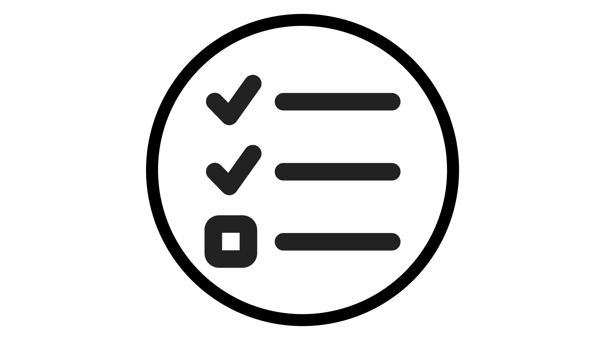
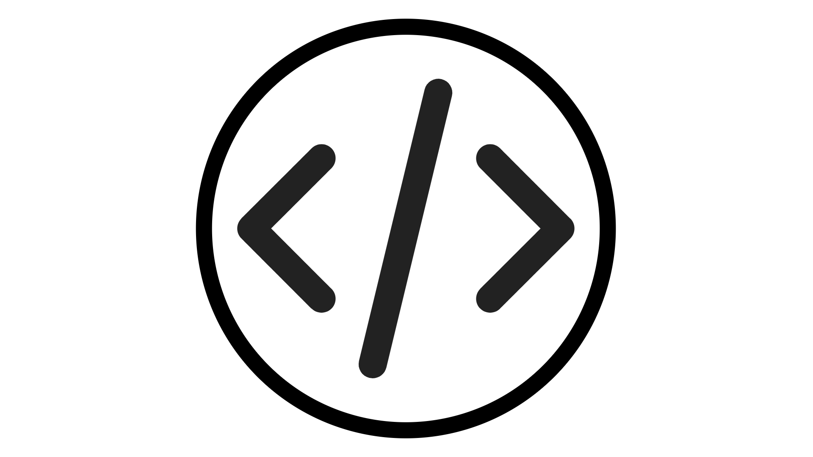

# 代理工具

<!-- last-modified: 2026-06-08 -->

並非每個代理程式工具都有相同的需求。 探索每個專案的功能、使用時間以及如何開始，讓您選擇適合自己情況的正確起點。

<!--
CARDS

* mcp-servers.md
  {title = MCP Servers}
  {description = Connect any compatible AI client to Adobe CX Enterprise data and workflows. No coding required.}
  {cta = Explore MCP Servers}
  {image = ../assets/mcp-servers-card.png}

* agent-skills.md
  {title = Agent Skills}
  {description = Adobe-curated workflow instructions that guide agents through CX Enterprise tasks consistently.}
  {cta = Explore Agent Skills}
  {image = ../assets/agent-skills-card.png}

* apis.md
  {title = APIs for Builders}
  {description = Build custom applications and integrations using the same APIs that power Adobe products.}
  {cta = Explore APIs for Builders}
  {image = ../assets/apis-card.png}

-->
<!-- START CARDS HTML - DO NOT MODIFY BY HAND -->

    

        

            

                <figure class="image x-is-16by9">
                    
                </figure>
            

            

                

                    

                        <a href="mcp-servers.md" target="_blank" rel="referrer" title="MCP伺服器">MCP伺服器</a>
                    

                    
將任何相容的AI使用者端連線至Adobe CX Enterprise資料和工作流程。 不需要編碼。

                

                <a href="mcp-servers.md" target="_blank" rel="referrer" class="spectrum-Button spectrum-Button--outline spectrum-Button--primary spectrum-Button--sizeM" style="align-self: flex-start; margin-top: 1rem;">
                    探索MCP伺服器
                </a>
            

        

    

    

        

            

                <figure class="image x-is-16by9">
                    
                </figure>
            

            

                

                    

                        <a href="agent-skills.md" target="_blank" rel="referrer" title="代理程式技能">代理程式技能</a>
                    

                    
由Adobe組織的工作流程指示，可引導代理程式一致地完成CX Enterprise工作。

                

                <a href="agent-skills.md" target="_blank" rel="referrer" class="spectrum-Button spectrum-Button--outline spectrum-Button--primary spectrum-Button--sizeM" style="align-self: flex-start; margin-top: 1rem;">
                    探索代理程式技能
                </a>
            

        

    

    

        

            

                <figure class="image x-is-16by9">
                    
                </figure>
            

            

                

                    

                        建置器的<a href="apis.md" target="_blank" rel="referrer" title="適用於建置器的API">API</a>
                    

                    
使用支援Adobe產品的相同API來建立自訂應用程式和整合。

                

                <a href="apis.md" target="_blank" rel="referrer" class="spectrum-Button spectrum-Button--outline spectrum-Button--primary spectrum-Button--sizeM" style="align-self: flex-start; margin-top: 1rem;">
                    探索建置器的API
                </a>
            

        

    

<!-- END CARDS HTML - DO NOT MODIFY BY HAND -->

## 比較代理工具

| | MCP伺服器 | 代理程式技能 | 適用於建置器的API |
| --- | --- | --- | --- |
| 最適合 | CX Enterprise應用程式使用者 | CX企業應用程式使用者和開發人員 | 開發人員 |
| 需要編碼 | 無 | 無 | 是 |
| 設定時間 | 分鐘 | 分鐘 | 小時到天 |
| 您的收穫 | 從您的AI使用者端存取CX Enterprise應用程式 | 引導式、可重複的工作流程 | 完整的程式化控制 |

## 不確定從何處開始？

- 若要使用AI與CX Enterprise應用程式互動（執行動作、查詢資料，以及讓AI透過自然對話來探索下一步要做什麼），[MCP伺服器](mcp-servers.md)是最靈活的起點。
- 若要讓代理程式持續遵循CX Enterprise工作流程的Adobe最佳實務，而不需要即興發揮，[代理程式技能](agent-skills.md)會針對可重複使用指示的網域專業知識進行編碼。
- 若要建置可簡化或自動化使用者特定CX Enterprise工作流程的重點應用程式，[建置程式適用的API](apis.md)可讓您直接、程式化地控制實際發生的情況。

>[!BEGINTABS]

>[!TAB MCP伺服器]

請將MCP伺服器想成是AI使用者端與CX Enterprise應用程式之間的即時連線。 連線一次，您的AI就可以查詢行銷活動、提取受眾、檢查歷程狀態等 — 全都以純文字顯示，不需要任何程式碼。

**使用MCP伺服器時：**

- 您想要將AI直接整合至CX Enterprise工作流程
- 您希望CX Enterprise資料位於已使用的AI使用者端中
- 您正在執行探索性分析或臨時資料擷取
- 您想要快速獲得結果，而不需要旋轉專案

[探索MCP伺服器](mcp-servers.md)

>[!TAB 代理程式技能]

代理商技能是Adobe的網域專業知識，會編碼為您的代理商可遵循的指示。 與其希望您的代理程式找出正確的步驟，不如用技能告訴它該做什麼 — 可靠、可重複，而且已針對CX企業工作流程進行調整。

**使用代理程式技能時間：**

- 透過AI使用者端在CX Enterprise應用程式中執行工作時，您想要遵循Adobe最佳實務
- 您想要每次都以相同的方式完成相同的工作
- 您正在執行可重複的內容或媒體製作工作流程

[探索代理程式技能](agent-skills.md)

>建置器的[!TAB API]

API是建置區塊。 它們可讓開發人員透過支援Adobe產品的API，以程式設計方式直接存取Adobe資料和作業。 運用這些工具，建置重點明確的自訂體驗，透過組織需求的護欄，簡化特定業務工作流程。

**使用API時間：**

- 您正在建置特定業務使用案例的自訂應用程式或整合
- 您需要使用特定護欄和控制項最佳化或自動化工作流程
- 您正在使用Claude程式碼或游標產生完整的應用程式
- 您需要將CX Enterprise資料整合到其他系統中

[探索建置器的API](apis.md)

>[!ENDTABS]

## 搭配使用

這些工具可搭配使用，將它們結合可讓您充分利用Adobe AI。 代理程式技能可指導AI使用者端如何使用MCP伺服器，讓代理程式在CX Enterprise工作流程中保持正確的方向。 技能也可以告知呼叫API的方法和時機，將Adobe最佳實務護欄新增到自訂自動化。 您不必只選擇一個。
