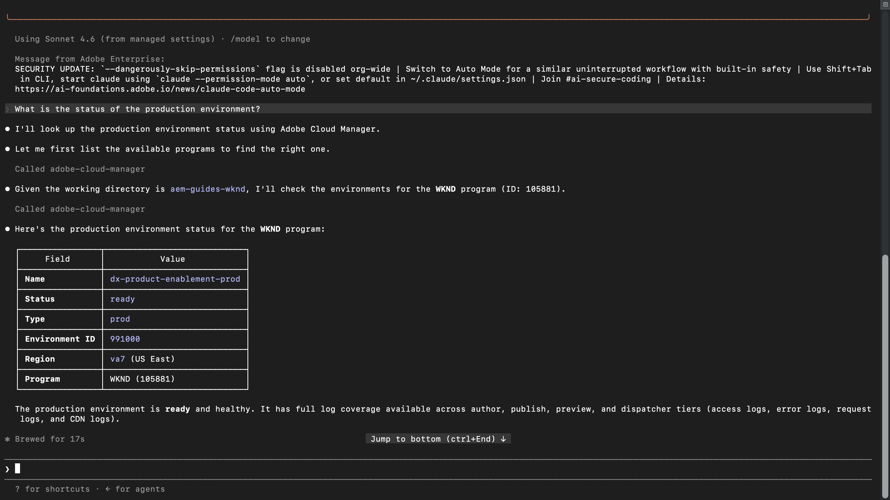
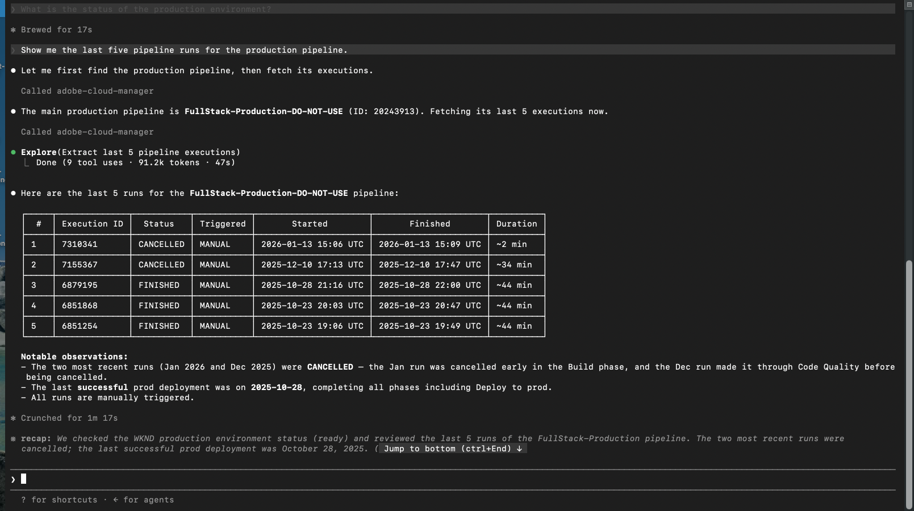
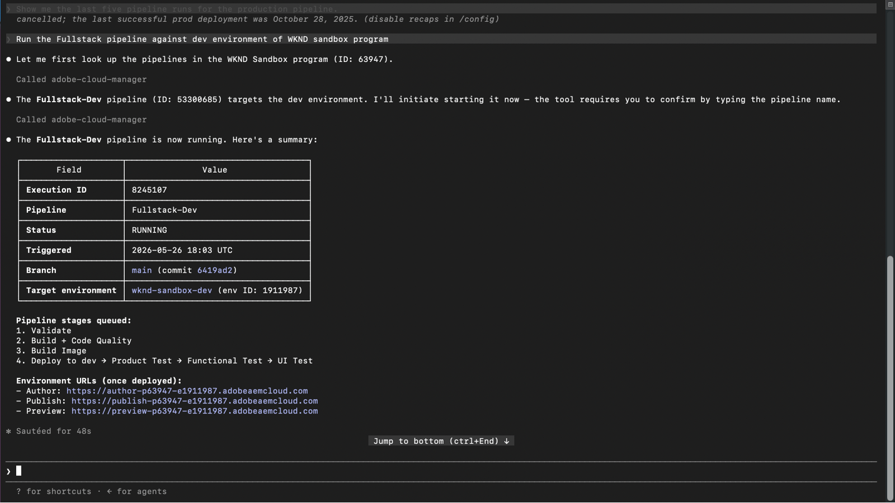
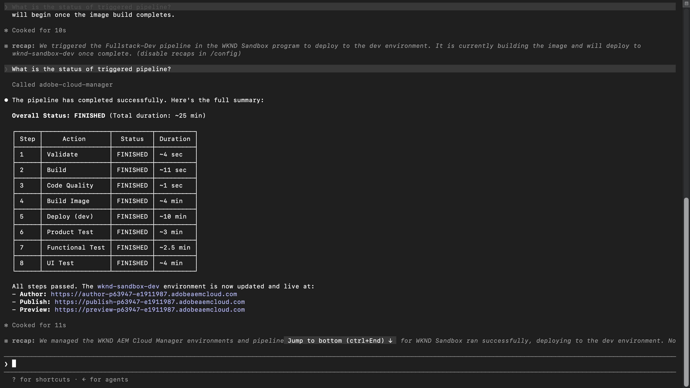

# 放心地部署至AEM as a Cloud Service

<!-- last-modified: 2026-05-21 -->

>[!VIDEO](https://video.tv.adobe.com/v/3480353/?captions=chi_hant&learn=on&enablevpops)

管理Adobe Experience Manager環境通常表示登入Cloud Manager、瀏覽管道和環境，以及切換內容以追蹤部署狀態。 本逐步解說會說明如何使用AEM Cloud Manager MCP伺服器從AI使用者端處理這些作業，讓開發人員和作業團隊可以檢查狀態、檢閱管道並在不離開AI環境的情況下處理部署詳細資訊。

| | |
| --- | --- |
| CX企業應用程式 | Adobe Experience Manager Cloud Manager |
| 代理工具 | AEM Cloud Manager MCP伺服器 |
| 對象 | 開發人員、DevOps、營運團隊 |
| 先決條件 | MCP相容的AI使用者端、AEM Cloud Manager存取 |

每個步驟會顯示一個代表性提示和範例AI回應。 接著有&#x200B;**更多提示嘗試**&#x200B;區段，以供您在同一工作階段中進行其他探索。

## 開始之前

>[!BEGINTABS]

>[!TAB 克勞德程式碼]

先導覽至您的專案目錄，然後使用CLI新增Cloud Manager MCP伺服器：

```bash
claude mcp add --transport http adobe-cloud-manager https://mcp.adobeaemcloud.com/adobe/mcp/cloudmanager
```

或手動將其新增至專案根目錄中的`.mcp.json`：

```json
{
  "mcpServers": {
    "adobe-cloud-manager": {
      "type": "http",
      "url": "https://mcp.adobeaemcloud.com/adobe/mcp/cloudmanager"
    }
  }
}
```

重新啟動Claude程式碼。 您可在下一個工作階段中使用Cloud Manager工具。

完整設定： [克勞德程式碼MCP檔案](https://docs.anthropic.com/en/docs/claude-code/mcp)

>[!TAB 游標]

將Cloud Manager MCP伺服器新增至專案根目錄中的`~/.cursor/mcp.json` （全域）或`.cursor/mcp.json`：

```json
{
  "mcpServers": {
    "adobe-cloud-manager": {
      "type": "http",
      "url": "https://mcp.adobeaemcloud.com/adobe/mcp/cloudmanager"
    }
  }
}
```

開啟&#x200B;**設定> MCP**，選取伺服器旁的&#x200B;**連線**，然後使用您的Adobe ID登入。

完整設定： [Cursor MCP檔案](https://cursor.com/docs/mcp)

>[!TAB GitHub Copilot]

將Cloud Manager MCP伺服器新增至專案根目錄中的`.vscode/mcp.json`：

```json
{
  "servers": {
    "adobe-cloud-manager": {
      "type": "http",
      "url": "https://mcp.adobeaemcloud.com/adobe/mcp/cloudmanager"
    }
  }
}
```

注意： VS程式碼使用`"servers"`做為最上層索引鍵，而不是`"mcpServers"`。

開啟&#x200B;**GitHub Copilot Chat**&#x200B;面板，切換至&#x200B;**代理程式模式**，然後選取伺服器旁的&#x200B;**連線**。 MCP工具僅適用於「代理程式」模式。

完整設定： [VS程式碼MCP伺服器檔案](https://code.visualstudio.com/docs/copilot/customization/mcp-servers)

>[!TAB 其他AI使用者端]

使用其他MCP相容的環境？ 使用此端點連線至Cloud Manager MCP伺服器：

```
https://mcp.adobeaemcloud.com/adobe/mcp/cloudmanager
```

所有支援使用者端的完整設定指示： [連線到您的AI使用者端](../tools/mcp-servers.md)

>[!ENDTABS]

>[!NOTE]
>
>出現提示時，請使用您的Adobe ID登入，並選取連結至您的AEM as a Cloud Service程式的IMS組織。 許可權是在Cloud Manager層級強制執行 — 您的AI使用者端只能執行您的帳戶獲授權的操作。
>
>在首次連線時，您的AI使用者端可能會要求您確認您的組織或AEM程式。 設定該內容後，MCP伺服器會將其用於工作階段的其餘部分。
>
>有些工具在執行前會提示您核准。 檢閱提議的動作並核准或拒絕 — 未經您的確認不會採取任何動作。

## 步驟1：檢查環境狀態

在開始發行之前，請確認您的環境是否健康且沒有任何專案正在執行中。

```
What is the status of the production environment?
```

+++檢視範例回應



+++


## 步驟2：檢閱管道執行

檢閱最近的管道歷史記錄，以瞭解部署模式並攔截失敗，然後才會封鎖您的下一個版本。

```
Show me the last five pipeline runs for the production pipeline.
```

+++檢視範例回應



+++


## 步驟3：觸發管道

啟動直接從您的AI使用者端執行的管道。 伺服器會確認目標環境，並在啟動前要求核准。

```
Run the Fullstack pipeline against dev environment of WKND sandbox program.
```

+++檢視範例回應



+++


>[!CAUTION]
>
>AI使用者端會在觸發執行之前要求您確認管道名稱。 輸入確切的管線名稱以繼續。 在確認之前，請仔細檢視目標環境，特別是對於部署到生產環境的管道。

## 步驟4：檢查管道狀態

觸發執行後，請要求您的AI使用者端進行狀態更新，而不切換至Cloud Manager介面。

```
What is the status of the triggered pipeline?
```

+++檢視範例回應



+++


## 您完成的內容

您使用AEM Cloud Manager MCP伺服器檢查環境健康情況、檢閱管道歷史記錄、觸發部署及驗證其狀態（無需開啟Cloud Manager介面）。 透過在單一AI工作階段中結合環境可見度和部署控制，開發和營運團隊可以更快回應問題，並將其工作流程儲存在他們已使用的工具內。

## 您可以完成更多工作

Cloud Manager MCP伺服器的處理能力，遠不止上述逐步說明所涵蓋的範圍。 展開下列案例以檢視可在相同工作階段中嘗試的提示。

+++在發行版本推出前發現問題

部署通常因管道執行之前可見的原因而失敗。 這些提示可協助您確認環境健康狀態、檢查衝突的執行以及驗證環境間的版本一致性，然後再確認發行。

**提示**

```
We're about to kick off a production release. Give me a full status check on all environments first.
```

```
Is there anything currently running in the staging pipeline? I don't want to queue on top of an active run.
```

```
Before I promote main branch to production, confirm main was deployed to Dev and all environments are on the same AEM version.
```

```
What repositories are connected to the WKND program?
```

+++

+++課程修正已在執行中的部署

意外觸發或核准門停止可能會級聯到受阻的管道或不需要的部署。 這些提示可讓您取消或推進執行中的管道，而無需切換至Cloud Manager介面。

**提示**

```
The staging pipeline kicked off by mistake. Cancel it before it deploys.
```

```
The release pipeline is waiting at the approval gate. Advance it to continue the deployment.
```

+++

+++瞭解您的部署歷程記錄

瞭解上次成功的時間、管道執行的時間長短，以及模式是否正在變更，可協助您規劃發行並在變更為事件之前捕捉緩慢的降級情況。 使用這些提示來隨選提取該記錄。

**提示**

```
What is the status of the last production pipeline execution? If it failed, explain why.
```

```
When was the last successful deployment to the staging environment?
```

```
Our pipeline times are creeping up. What's the longest run we've had in the last 30 days?
```

+++

+++讓中斷的組建回到正軌

當管道發生故障時，解決問題的最快路徑是瞭解其確切損壞位置以及原因。 這些會提示表面失敗詳細資料、變更記錄和品質閘道問題，讓您的團隊無需手動挖掘記錄即可診斷和修正。

**提示**

```
We're seeing a regression on the live site. What changed in production over the last week?
```

```
Which pipelines have failed in the last 7 days, and at what stage did they fail?
```

```
The last pipeline failed at the code quality step. What specific issues need to be fixed before I can retry?
```

```
Pull the step logs for the last failed run. I need to see exactly what the quality gate flagged.
```

+++


## 進一步資訊

| 資源 | 您會找到的內容 |
| --- | --- |
| [AEM Cloud Manager檔案](https://experienceleague.adobe.com/en/docs/experience-manager-cloud-service/content/implementing/using-cloud-manager/introduction-to-cloud-manager) | 完整的Cloud Manager應用程式檔案 |
| [AEM as a Cloud Service 文件](https://experienceleague.adobe.com/zh-hant/docs/experience-manager-cloud-service) | 完整的AEM應用程式檔案 |
| [MCP伺服器](../tools/mcp-servers.md) | 將AI使用者端連線至Adobe MCP伺服器 |
