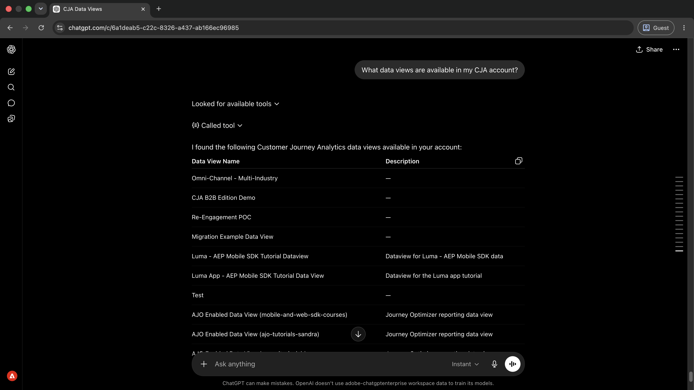
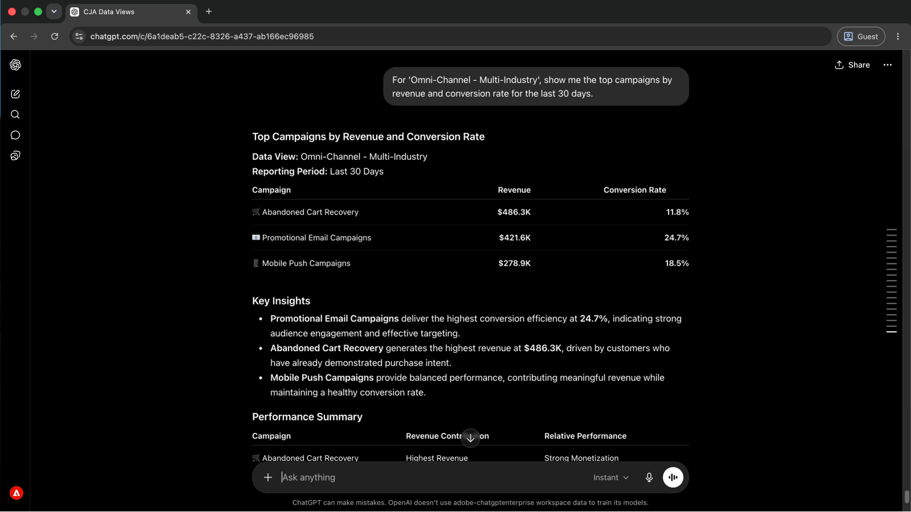
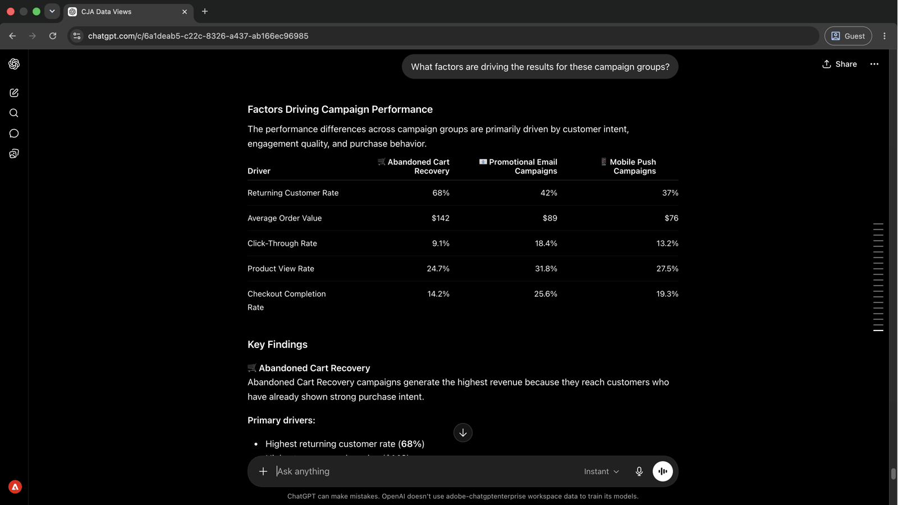
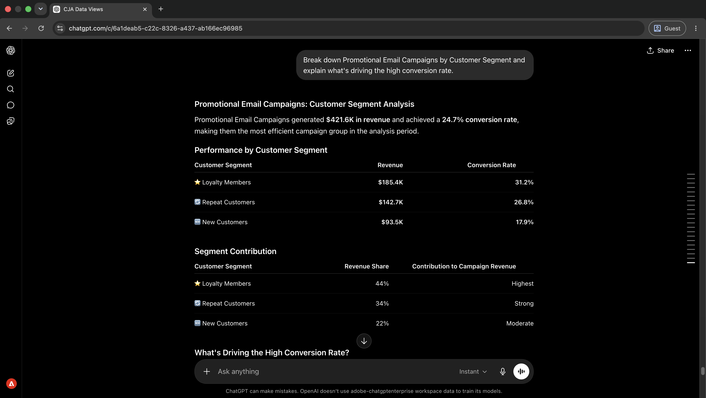
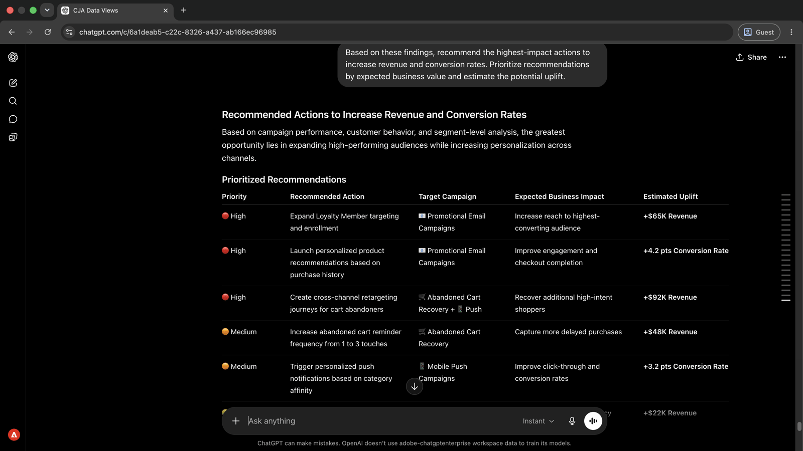

# 無需建立報表即可呈現行銷活動深入分析

<!-- last-modified: 2026-06-02 -->


促銷活動分析過去需要在不同的工具中建立報表，現在則變成對話。 此逐步解說會示範如何將AI使用者端連線至Customer Journey Analytics (CJA)，並以淺顯的語言詢問效能問題。 如此可加快前往insight的時間，且無需手動建立報表。

| | |
| --- | --- |
| CX企業應用程式 | Customer Journey Analytics (CJA) |
| 代理工具 | CX Enterprise MCP閘道 |
| 對象 | 分析人員、行銷活動經理 |
| 先決條件 | MCP相容的AI使用者端、CJA存取 |

每個步驟會顯示一個代表性提示和範例AI回應。 您可以完成更多&#x200B;**個**&#x200B;區段，在同一工作階段中進行更多探索。

## 開始之前

>[!BEGINTABS]

>[!TAB Claude.ai]

以自訂聯結器的形式連線CX Enterprise MCP Gateway，以存取Customer Journey Analytics工具。

1. 移至Claude.ai中的&#x200B;**設定>整合**。
2. 選取&#x200B;**新增自訂聯結器**&#x200B;並輸入伺服器URL： `https://cx-enterprise.adobe.io/mcp`
3. 選取&#x200B;**連線**&#x200B;並使用您的Adobe ID登入。

完整設定： [Claude.ai自訂聯結器檔案](https://support.claude.com/en/articles/11175166-get-started-with-custom-connectors-using-remote-mcp)

>[!TAB ChatGPT]

使用ChatGPT Developer Mode （需要Pro、Plus、Business、Enterprise或Education計畫）連線CX Enterprise MCP Gateway。

1. 在&#x200B;**ChatGPT設定**&#x200B;中啟用&#x200B;**開發人員模式**。
2. 移至&#x200B;**設定>整合**&#x200B;並選取&#x200B;**新增自訂聯結器>遠端MCP伺服器**。
3. 輸入伺服器URL： `https://cx-enterprise.adobe.io/mcp`
4. 選取&#x200B;**連線**&#x200B;並使用您的Adobe ID登入。

完整設定： [ChatGPT MCP檔案](https://developers.openai.com/api/docs/guides/tools-connectors-mcp)

>[!TAB 其他AI使用者端]

使用Gemini、Microsoft Copilot、Cursor、Claude Code或其他與MCP相容的環境嗎？ 使用此端點連線到CX Enterprise MCP Gateway：

```
https://cx-enterprise.adobe.io/mcp
```

所有支援使用者端的完整設定指示： [連線到您的AI使用者端](../tools/mcp-servers.md)

>[!ENDTABS]

>[!NOTE]
>
>出現提示時，請使用您的Adobe ID登入，並選取連結至您的CJA資料檢視的IMS組織。 選擇錯誤的組織是驗證錯誤最常見的來源。
>
>在首次連線時，您的AI使用者端可能會要求您選取IMS組織或指定沙箱。 設定該內容後，MCP伺服器會將其用於工作階段的其餘部分。
>
>有些工具在執行前會提示您核准。 檢閱請求並核准或拒絕 — 未經您的確認不會採取任何動作。

## 步驟1：探索可用的資料檢視

首先，請您的AI使用者端列出您CJA帳戶中可用的資料檢視。 這可以告訴您在執行任何報表之前可以查詢哪些資料集。

```
What data views are available in my CJA account?
```

+++檢視範例回應



+++


## 步驟2：提取行銷活動績效資料

在已識別資料檢視後，依收入和轉換率要求行銷活動績效。 AI會從資料檢視解析量度和維度名稱，不需要技術ID。

```
For '[data view name]', show me the top campaigns by revenue and conversion rate for the last 30 days.
```

+++檢視範例回應



+++


>[!NOTE]
>
>將`[data view name]`取代為您步驟1的資料檢視名稱。 在與利害關係人共用之前，使用相同的資料檢視和日期範圍在Analysis Workspace中交叉檢查結果。

## 步驟3：找出驅動效能的因素

請要求您的AI使用者端說明導致不同行銷活動群組間效能差異的原因。 這會從標題數字移至其下的變數。

```
What factors are driving the results for these campaign groups?
```

+++檢視範例回應



+++


## 步驟4：深入研究特定的行銷活動型別

要求區段層級劃分以跟進特定發現。 這會顯示哪些客戶型別在促銷活動型別中提升效能。

```
Break down Promotional Email Campaigns by Customer Segment and explain what's driving the high conversion rate.
```

+++檢視範例回應



+++


## 步驟5：對找到的專案採取動作

根據工作階段中呈現的所有內容，請求排定優先順序的建議。 要求業務價值預估可協助您決定要先採取行動的位置。

```
Based on these findings, recommend the highest-impact actions to increase revenue and conversion rates. Prioritize recommendations by expected business value and estimate the potential uplift.
```

+++檢視範例回應



+++


>[!NOTE]
>
>透過CX Enterprise MCP Gateway存取的CJA工具，可在相同工作階段中，於CJA內建立區段、計算量度和Workspace專案。 若要更新其他應用程式中的促銷活動、歷程或內容，請連線相關的MCP伺服器或直接前往應用程式。

## 您完成的內容

您已將AI使用者端連線至Customer Journey Analytics，並在五個提示中從資料檢視探索移至優先的商業建議。 您透過收入和轉換率找出排名最高的行銷活動、瞭解跨行銷活動群組推動績效的因素、鑽研至特定行銷活動型別的區段層級詳細資訊，並收到具有估計提升度的排名建議。 此方法以直接對話取代報告建置，縮短業務問題與資料支援行動計畫之間的時間。

## 您可以完成更多工作

CX Enterprise MCP Gateway可呈現的Customer Journey Analytics深入解析遠多於逐步解說。 展開下列案例以檢視可在相同工作階段中嘗試的提示。

+++找出有效與無效的內容

快速瞭解正在提供哪些行銷活動以及哪些行銷活動並無法協助您在檢閱任何詳細報告之前集中精力。 這些提示會在一個工作階段中為您提供該圖片。

**提示**

```
Which campaigns are driving the most revenue and conversions?
```

```
Show me the campaigns that need attention this month.
```

```
What channels are outperforming expectations?
```

```
Identify the biggest performance changes compared to last month.
```

```
Show me conversion performance by traffic source.
```

+++

+++瞭解促成成果的原因

標題量度會告訴您發生了什麼。 這些提示可協助您瞭解為什麼 — 數字背後是哪些區段、管道和接觸點。

**提示**

```
What factors are driving revenue growth?
```

```
Explain why conversion rates changed this quarter.
```

```
Break down campaign performance by customer segment.
```

```
Which customer segments are growing fastest?
```

```
Which touchpoints contribute most to conversions?
```

+++

+++發現成長機會

瞭解效能強於何處只是圖畫的一半。 這些提示可協助您識別您可在何處投入更多資金、哪些對象有剩餘空間，以及哪些行銷活動可準備進行縮放。

**提示**

```
Where should we invest more marketing budget?
```

```
Which audiences have the greatest growth potential?
```

```
Which campaigns should we scale?
```

```
What would have the biggest impact on revenue?
```

+++

+++將深入分析轉化為行動

透過CX Enterprise MCP Gateway存取的CJA工具可直接在CJA中建立區段、對象、計算量度和Workspace專案，無需離開您的AI工作階段。 使用這些提示來根據您的發現採取行動。

**提示**

```
Create a segment for high-value customers.
```

```
Build an audience from recent purchasers.
```

```
Create a calculated metric for conversion efficiency.
```

```
Save this analysis as a Workspace project for executive reporting.
```

+++


## 進一步資訊

| 資源 | 您會找到的內容 |
| --- | --- |
| [CJA MCP伺服器檔案](https://developer.adobe.com/analytics-mcp/docs/cja/) | 完整的工具參考與設定指南 |
| [CJA MCP使用指南](https://developer.adobe.com/analytics-mcp/docs/guides/) | 詳細使用指南 |
| AI登入中的[CJA MCP伺服器](https://developer.adobe.com/ai-registry/#/mcp/cja-mcp) | CJA MCP伺服器工具與可用性 |
| [Customer Journey Analytics檔案](https://experienceleague.adobe.com/en/docs/analytics-platform/using/cja-landing) | 完整的CJA應用程式檔案 |
