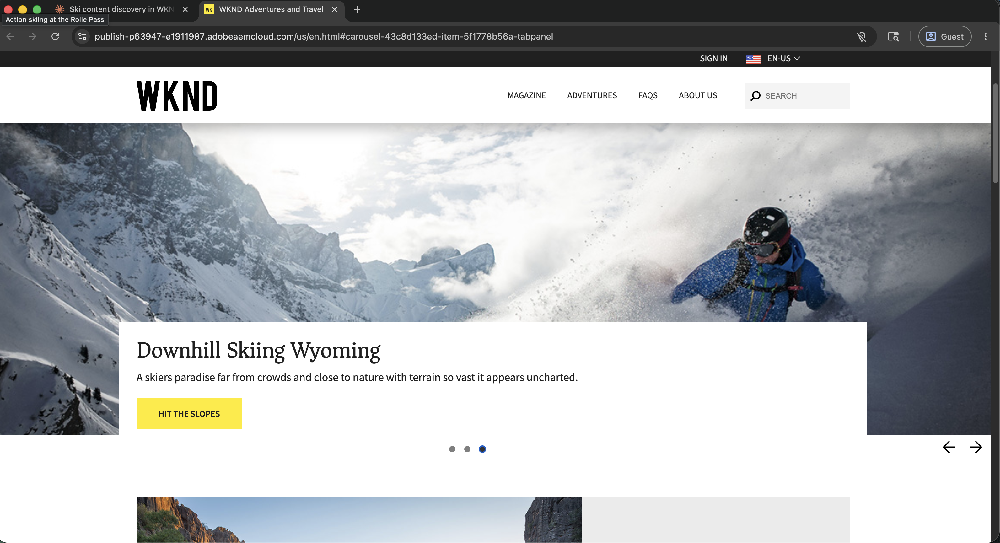
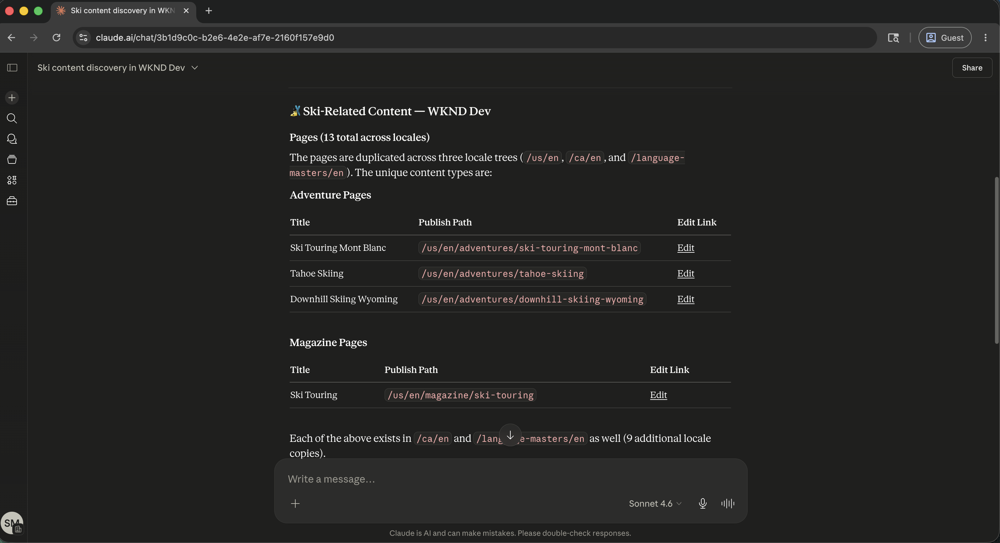
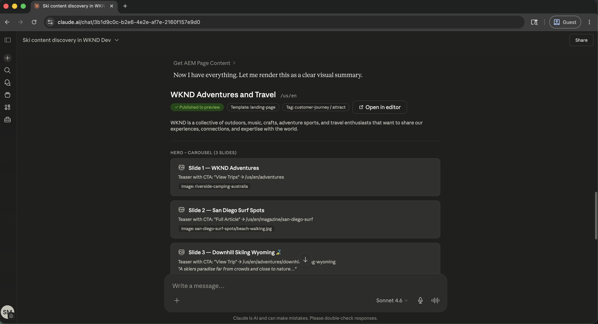
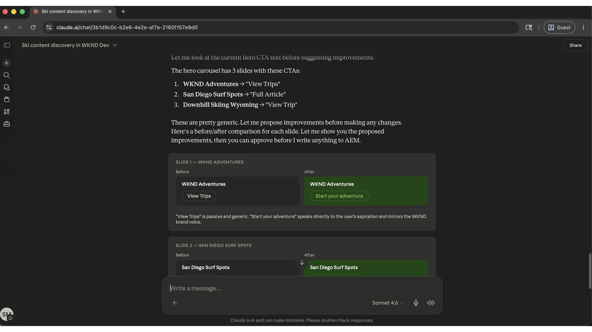
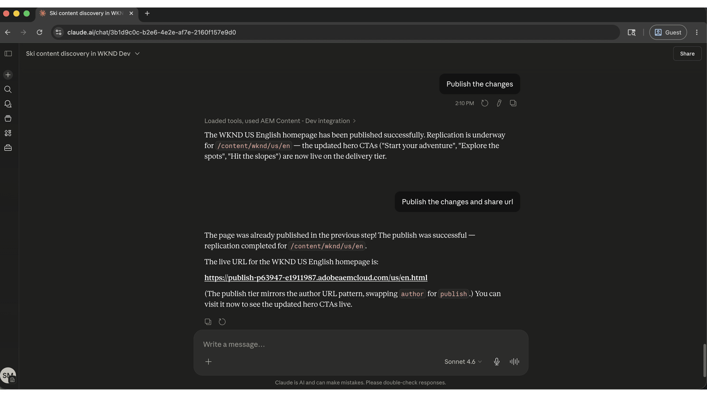

# 保持內容最新狀態，並加快傳送更新的速度

<!-- last-modified: 2026-05-22 -->



Adobe Experience Manager中的內容操作，從尋找頁面和檢閱內容到進行更新及發佈，通常需要直接導覽AEM介面。 此逐步解說會說明如何使用AEM Content MCP Server透過AI使用者端處理這些作業，讓內容團隊可以更快速地移動，而無需在工具之間切換內容。

| 案例詳細資料 | |
| --- | --- |
| CX企業應用程式 | [Adobe Experience Manager as a Cloud Service](https://experienceleague.adobe.com/zh-hant/docs/experience-manager-cloud-service/content/overview/introduction) |
| 代理工具 | [AEM Content MCP伺服器](https://experienceleague.adobe.com/en/docs/experience-manager-cloud-service/content/ai-in-aem/using-mcp-with-aem-as-a-cloud-service) |
| 對象 | 內容管理員、行銷團隊 |
| 先決條件 | MCP相容的AI使用者端、AEM as a Cloud Service存取 |

每個步驟會顯示一個代表性提示和範例AI回應。 您可以完成更多&#x200B;**個**&#x200B;區段，在同一工作階段中進行更多探索。

## 開始之前

>[!BEGINTABS]

>[!TAB Claude.ai]

以自訂聯結器連線AEM Content MCP Server。

1. 移至Claude.ai中的&#x200B;**設定>整合**。
2. 選取&#x200B;**新增自訂聯結器**&#x200B;並輸入伺服器URL： `https://mcp.adobeaemcloud.com/adobe/mcp/content`
3. 選取&#x200B;**連線**&#x200B;並使用您的Adobe ID登入。

完整設定： [Claude.ai自訂聯結器檔案](https://support.claude.com/en/articles/11175166-get-started-with-custom-connectors-using-remote-mcp)

>[!TAB ChatGPT]

使用ChatGPT開發人員模式（需要Pro、Plus、Business、Enterprise或Education計畫）連線AEM Content MCP Server。

1. 在&#x200B;**ChatGPT設定**&#x200B;中啟用&#x200B;**開發人員模式**。
2. 移至&#x200B;**設定>整合**&#x200B;並選取&#x200B;**新增自訂聯結器>遠端MCP伺服器**。
3. 輸入伺服器URL： `https://mcp.adobeaemcloud.com/adobe/mcp/content`
4. 選取&#x200B;**連線**&#x200B;並使用您的Adobe ID登入。

完整設定： [ChatGPT MCP檔案](https://developers.openai.com/api/docs/guides/tools-connectors-mcp)

>[!TAB 其他AI使用者端]

使用Gemini、Microsoft Copilot、Cursor、Claude Code或其他與MCP相容的環境嗎？ 使用此端點連線至AEM Content MCP伺服器：

```
https://mcp.adobeaemcloud.com/adobe/mcp/content
```

所有支援使用者端的完整設定指示： [連線到您的AI使用者端](../tools/mcp-servers.md)

>[!ENDTABS]

>[!NOTE]
>
>出現提示時，請使用您的Adobe ID登入，並選取連結至您的AEM as a Cloud Service環境的IMS組織。 許可權會在AEM層級強制執行。 您的AI使用者端只能執行您的帳戶所授權的操作。
>
>如果您只需要瀏覽或稽核內容而不需進行變更，請改用唯讀伺服器端點： `https://mcp.adobeaemcloud.com/adobe/mcp/content-readonly`。 此頁面上的所有探索和檢閱提示都適用於這兩個伺服器。
>
>在首次連線時，您的AI使用者端可能會要求您確認您的組織或AEM環境。 設定該內容後，MCP伺服器會將其用於工作階段的其餘部分。
>
>有些工具在執行前會提示您核准。 檢閱建議的動作，並核准或拒絕。 未經您的確認，不會進行任何變更。

## 步驟1：在您的AEM環境中尋找內容

首先，請您的AI使用者端探索您的AEM環境並搜尋內容。 您可以依主題、關鍵字或內容型別搜尋，而不需要知道確切路徑。

```
From WKND Dev environment, find all ski related content.
```

+++檢視範例回應



+++


## 步驟2：檢閱特定頁面

找到相關內容後，請要求您的AI使用者端顯示特定頁面。 您可以依名稱或路徑參照頁面。 MCP伺服器會解析參考並傳回內容結構。

```
Show me the US English Home Page.
```

+++檢視範例回應



+++


## 步驟3：改善內容

檢視頁面內容後，請要求您的AI使用者端提出改進或套用改進。 AI可以根據頁面目前所顯示的內容提出副本變更，並在寫入任何內容之前要求確認。

```
Improve the Hero CTAs.
```

+++檢視範例回應



+++


>[!CAUTION]
>
>出現提示時確認每個變更。 AEM Content MCP Server可以建立、更新和刪除內容。 核准前，請先檢閱提議的變更，尤其是在即時頁面上。

## 步驟4：發佈和共用

確認更新後，發佈頁面並擷取可共用的URL，全都透過相同的對話進行。

```
Publish the changes and share the URL.
```

+++檢視範例回應



+++


## 您完成的內容

您在不開啟AEM介面的情況下，使用AEM Content MCP Server來尋找內容、檢閱即時頁面、套用AI建議的改進以及發佈結果。 透過在單一AI工作階段中結合內容探索、編輯和發佈，內容團隊可以從識別間隙轉移到以更快的速度和更少的內容切換送出更新。 相同的工作流程可縮放至多個頁面、內容片段，以及協調的行銷活動啟動。

## 您可以完成更多工作

AEM Content MCP Server處理的內容遠不止逐步解說。 展開下列案例以檢視可在相同工作階段中嘗試的提示。

+++搶先進行網站檢閱或重新啟動

手動完成內容稽核相當耗時。 這些提示可協助您快速顯示過時內容、從未出貨的草稿，以及需要在重大推播之前修復的間隙。

**提示**

```
Show me everything updated in the last two weeks.
```

```
What content is sitting in draft and hasn't been published yet?
```

```
Find pages that haven't been touched in over a year.
```

```
Which pages are missing their description field?
```

```
We're reorganizing the taxonomy. Find all articles missing tags or categories.
```

+++

+++大規模修正SEO和協助工具問題

SEO和協助工具間隙可快速在大型網站間複合。 這些提示可協助您在稽核或啟動之前，找到並優先處理最重要的問題。

**提示**

```
Pull a list of all pages with an empty meta description.
```

```
Which pages have thin content that's likely to underperform for SEO?
```

```
Find all images missing alt text.
```

```
Our CTAs aren't consistent. Scan the site and flag anywhere the call-to-action wording differs from "Book now."
```

```
The homepage was updated yesterday. Show me what changed compared to the version before.
```

+++

+++讓您的資產庫維持井然有序，隨時待命

中斷的資產參考和未處理的上傳會減慢內容生產的速度。 這些提示可協助您在資產封鎖頁面更新或行銷活動之前尋找和管理資產。

**提示**

```
We're building a biking content series. What image assets do we already have?
```

```
Can you upload a placeholder asset from https://placehold.co/800x450/png to the wknd folder and save it as placeholder.png?
```

```
That asset was just uploaded. Is it processed and ready to use in a page?
```

```
I need to replace the hero image across the site. Which fragments are currently using it?
```

+++

+++協調多個頁面上的內容啟動

啟動行銷活動通常表示要協調多個內容片段和頁面之間的變更。 這些提示可協助您群組更新、升級前檢閱及整潔出貨。

**提示**

```
I need to update the surfing adventure. Show me its content and all its fields.
```

```
Create an EMEA market variation of the ski adventure fragment.
```

```
Bundle everything we changed in this session into a launch called May Updates.
```

```
What launches are open right now, and which ones are ready to promote?
```

```
Before I promote, show me exactly what changed between May Updates and what is currently live.
```

```
Promote the May Updates launch to production.
```

+++


## 進一步資訊

| 資源 | 您會找到的內容 |
| --- | --- |
| [AI登入中的AEM Content MCP伺服器](https://developer.adobe.com/ai-registry/#/mcp/aem-content-mcp){target="_blank"} | 工具清單和可用性 |
| [AEM as a Cloud Service 文件](https://experienceleague.adobe.com/en/docs/experience-manager-cloud-service){target="_blank"} | 完整的AEM應用程式檔案 |
