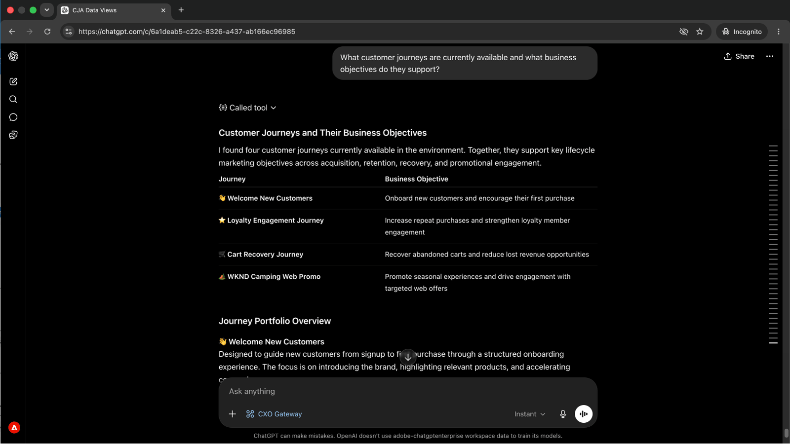
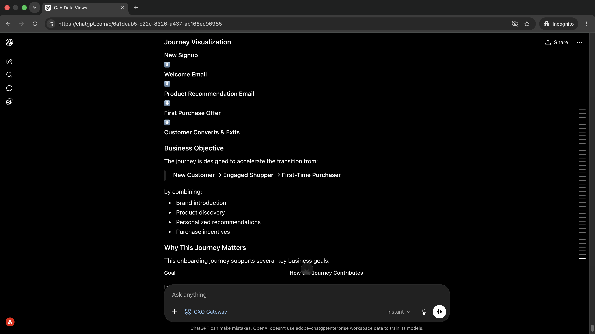
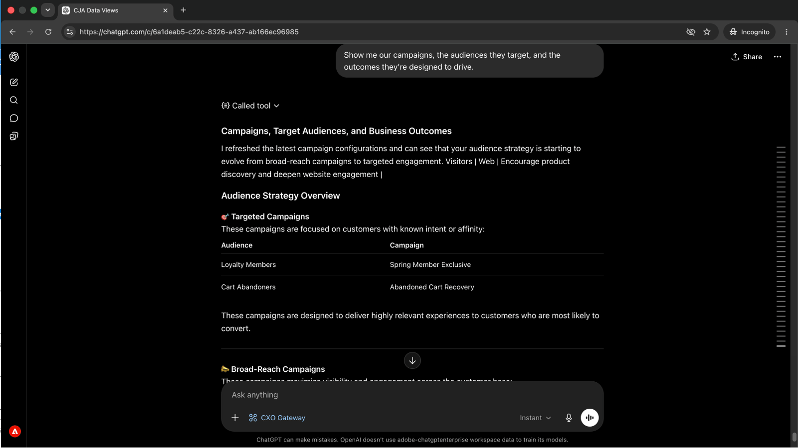
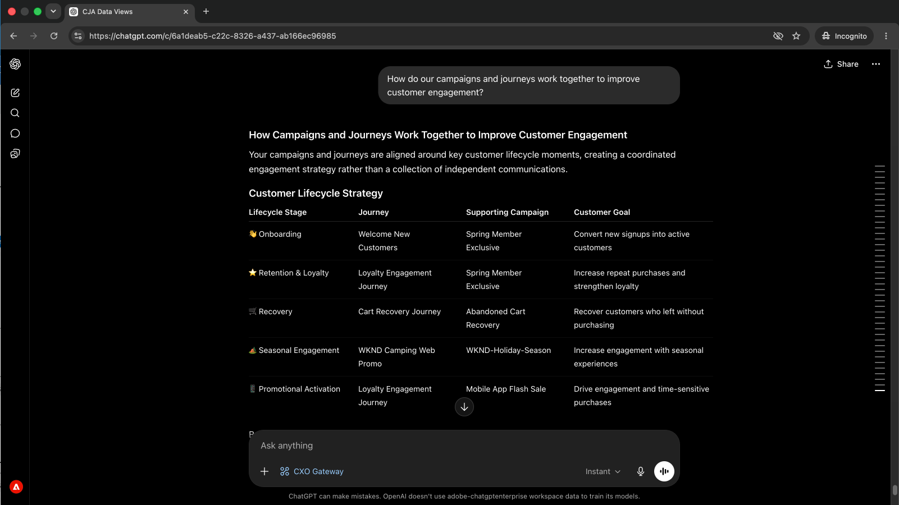
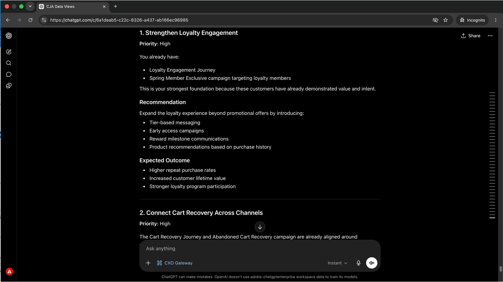

# 在影響客戶之前擷取歷程問題

<!-- last-modified: 2026-06-02 -->


清楚瞭解哪些歷程處於作用中狀態、哪些條件驅動這些歷程，以及行銷活動的設定方式通常意味著開啟Adobe Journey Optimizer並導覽其介面。 本逐步解說會說明如何透過AI使用者端取得同樣的可見度，使用CX Enterprise MCP Gateway透過簡單語言問題查詢AJO歷程和促銷活動資料。

| | |
| --- | --- |
| CX企業應用程式 | Adobe Journey Optimizer (AJO) |
| 代理工具 | CX Enterprise MCP閘道 |
| 對象 | 行銷活動管理員、行銷人員 |
| 先決條件 | MCP相容的AI使用者端、AJO存取 |

每個步驟會顯示一個代表性提示和範例AI回應。 您可以完成更多&#x200B;**個**&#x200B;區段，在同一工作階段中進行更多探索。

## 開始之前

>[!BEGINTABS]

>[!TAB Claude.ai]

以自訂聯結器的形式連線CX Enterprise MCP Gateway，以存取Adobe Journey Optimizer工具。

1. 移至Claude.ai中的&#x200B;**設定>整合**。
2. 選取&#x200B;**新增自訂聯結器**&#x200B;並輸入伺服器URL： `https://cx-enterprise.adobe.io/mcp`
3. 選取&#x200B;**連線**&#x200B;並使用您的Adobe ID登入。

完整設定： [Claude.ai自訂聯結器檔案](https://support.claude.com/en/articles/11175166-get-started-with-custom-connectors-using-remote-mcp)

>[!TAB ChatGPT]

使用ChatGPT Developer Mode （需要Pro、Plus、Business、Enterprise或Education計畫）連線CX Enterprise MCP Gateway。

1. 在&#x200B;**ChatGPT設定**&#x200B;中啟用&#x200B;**開發人員模式**。
2. 移至&#x200B;**設定>整合**&#x200B;並選取&#x200B;**新增自訂聯結器>遠端MCP伺服器**。
3. 輸入伺服器URL： `https://cx-enterprise.adobe.io/mcp`
4. 選取&#x200B;**連線**&#x200B;並使用您的Adobe ID登入。

完整設定： [ChatGPT MCP檔案](https://developers.openai.com/api/docs/guides/tools-connectors-mcp)

>[!TAB 其他AI使用者端]

使用Gemini、Microsoft Copilot、Cursor、Claude Code或其他與MCP相容的環境嗎？ 使用此端點連線到CX Enterprise MCP Gateway：

```
https://cx-enterprise.adobe.io/mcp
```

所有支援使用者端的完整設定指示： [連線到您的AI使用者端](../tools/mcp-servers.md)

>[!ENDTABS]

>[!NOTE]
>
>出現提示時，請使用您的Adobe ID登入，並選取連結至您的AJO環境的IMS組織。 選擇錯誤的組織是驗證錯誤最常見的來源。
>
>在首次連線時，您的AI使用者端可能會要求您選取IMS組織或指定沙箱。 設定該內容後，MCP伺服器會將其用於工作階段的其餘部分。
>
>有些工具在執行前會提示您核准。 檢閱請求並核准或拒絕 — 未經您的確認不會採取任何動作。

## 步驟1：探索作用中歷程及其用途

首先，請要求一份作用中歷程及其背後的業務目標清單。 這可讓您在投入任何特定歷程之前先瞭解全貌。

```
What customer journeys are currently available and what business objectives do they support?
```

+++檢視範例回應



+++

## 步驟2：檢閱歷程的步驟和客戶體驗

檢視歷程清單後，請要求您的AI使用者端完成特定歷程的步驟，並解釋客戶在每個階段的體驗。

```
Walk me through the [journey name] journey and explain the customer experience.
```

+++檢視範例回應



+++

>[!NOTE]
>
>以步驟1結果中的歷程名稱取代`[journey name]`。

## 步驟3：檢閱行銷活動、對象和目標

從歷程移至行銷活動。 要求摘要瞭解作用中的行銷活動、行銷活動的目標對象，以及行銷活動旨在推動的結果。

```
Show me our campaigns, the audiences they target, and the outcomes they're designed to drive.
```

+++檢視範例回應



+++

## 步驟4：瞭解行銷活動和歷程如何連結

要求您的AI使用者端連線行銷活動和歷程之間的點，並解釋他們如何共同努力達成共用的參與目標。

```
How do our campaigns and journeys work together to improve customer engagement?
```

+++檢視範例回應



+++

## 步驟5：取得優先建議

從生命週期行銷經理的角度出發，詢問優先建議，以瞭解後續要重點處理的專案。 從工作階段中檢閱的所有內容中，這會顯示最具影響力的差距和機會。

```
If you were our lifecycle marketing manager, what would you prioritize next and why?
```

+++檢視範例回應



+++

>[!NOTE]
>
>AJO MCP伺服器會顯示歷程和行銷活動資訊，但無法修改歷程、行銷活動或內容。 若要實作建議，請直接前往AJO應用程式，或連線AEM Content MCP Server以檢視相同工作階段中的內容變更。

## 您完成的內容

您將AI使用者端連線至Adobe Journey Optimizer，並透過五個提示建立您歷程和行銷活動產品組合的完整畫面。 您清查作用中歷程及其業務目標、檢閱特定歷程的逐步客戶體驗、將作用中行銷活動對應至其對象和預期結果、瞭解行銷活動和歷程如何連結，並收到優先建議，說明後續要聚焦於何處。 如此一來，生命週期行銷和行銷活動管理員就能在無需開啟AJO介面的情況下掌握策略重點。

## 您可以完成更多工作

CX Enterprise MCP Gateway可以呈現各種AJO歷程與行銷活動的詳細資訊。 展開下列案例以檢視可在相同工作階段中嘗試的提示。

+++在進行變更之前，請先瞭解哪些專案已上線

在不知道其他專案正在執行的情況下變更歷程是有風險的。 這些提示會為您提供目前作用中的專案、最近修改的專案以及行銷活動的設定方式等詳細目錄。

**提示**

```
Show me all journeys modified in the last 7 days.
```

```
Show me all journeys that use SMS as a channel.
```

```
Which campaigns are scheduled to end this week?
```

```
What loyalty challenges are currently active?
```

+++

+++深入瞭解特定歷程的詳細資訊

當您需要檢閱、核准或傳遞歷程時，無需開啟AJO即可將完整邏輯呈現在您面前，可節省時間。 這些會依需求提示表面條件、排程及區段規則。

**提示**

```
What is the entry condition for the [journey name] journey?
```

```
What are the exit conditions and timeout rules for the [journey name] journey?
```

```
What messages and wait conditions are in the [journey name] journey?
```

```
Which segment does the [journey name] journey target?
```

+++

+++深入瞭解特定行銷活動的詳細資料

當您需要在核准、傳送或變更之前稽核行銷活動的完整設定時，這些會提示顯示對象規則、頻道設定和排程詳細資料，而不需要開啟AJO。

**提示**

```
Walk me through the full configuration of the [campaign name] campaign.
```

```
What audience does the [campaign name] campaign target and how large is that segment?
```

```
What frequency cap and send schedule apply to the [campaign name] campaign?
```

```
Are any campaigns targeting overlapping audiences?
```

```
What channel configurations are set up in our AJO environment?
```

+++

## 進一步資訊

| 資源 | 您會找到的內容 |
| --- | --- |
| AI登入中的[AJO MCP伺服器](https://developer.adobe.com/ai-registry/#/mcp/ajo-mcp-server) | AJO MCP伺服器工具與可用性 |
| [AJO檔案](https://experienceleague.adobe.com/zh-hant/docs/journey-optimizer/using/ajo-home) | 完整的AJO應用程式檔案 |
| [AJO API](https://developer.adobe.com/journey-optimizer-apis/) | 自訂整合的AJO API參考 |
| [AJO教學課程](https://experienceleague.adobe.com/zh-hant/docs/journey-optimizer-learn/tutorials/overview) | 教學課程影片和學習路徑 |
