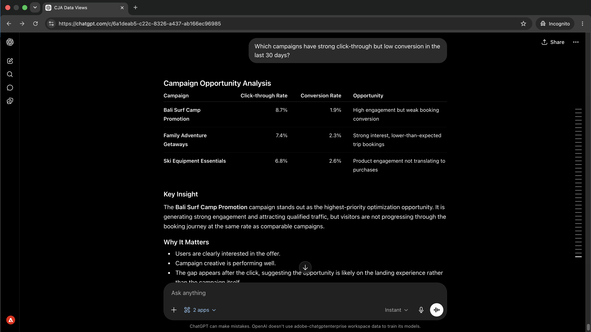
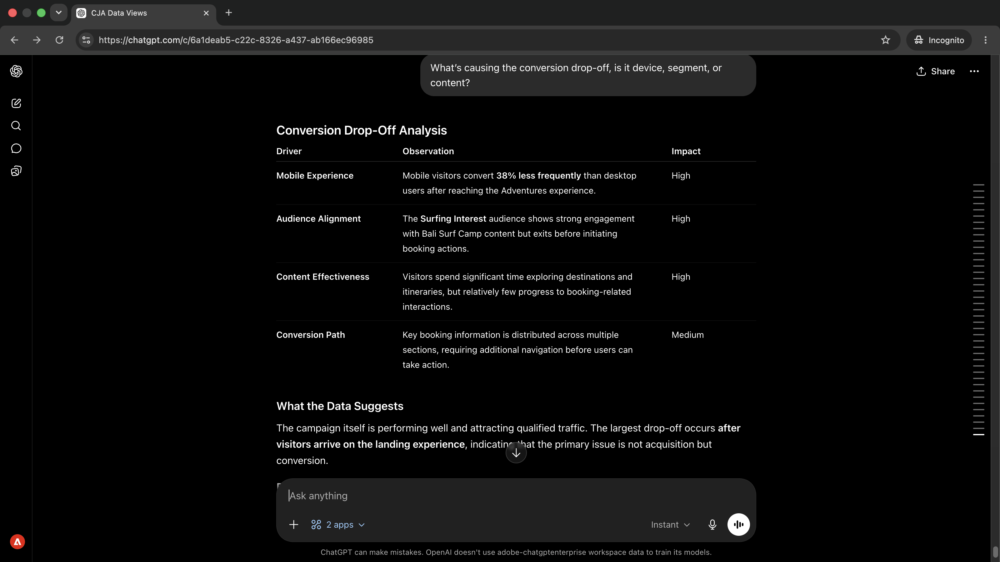
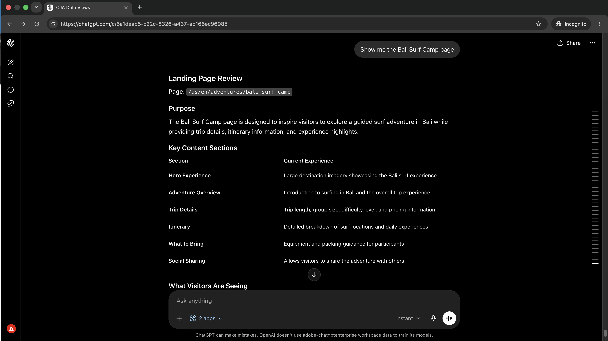
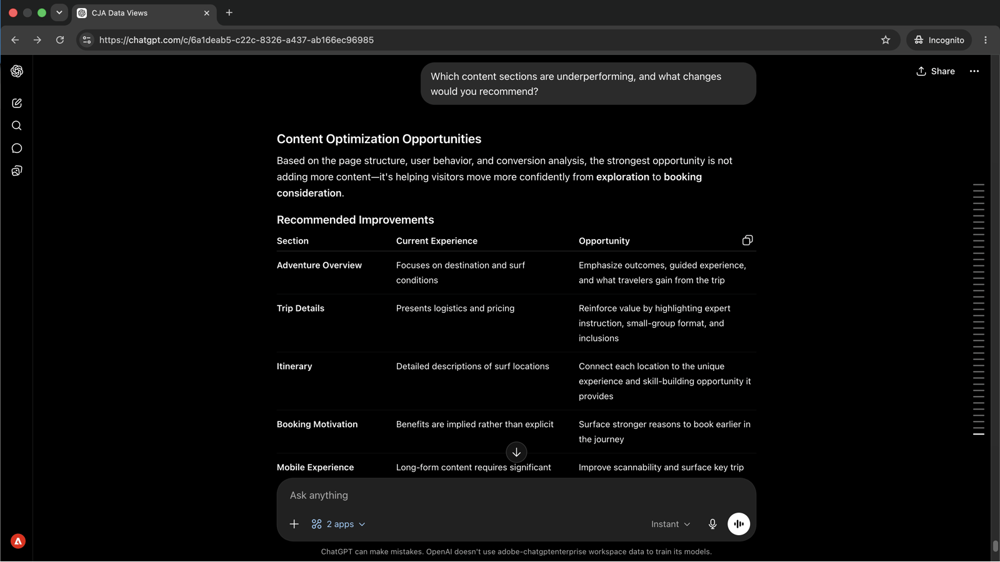
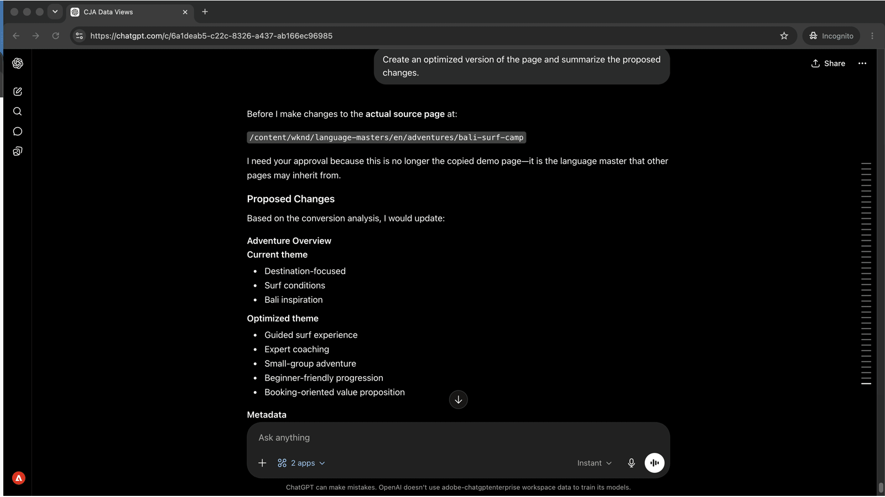

# 根據效能資料最佳化內容
<!-- last-modified: 2026-06-08 -->


一般而言，關閉行銷活動績效資料與內容更新之間的回圈，就表示要在您的分析工具與CMS之間切換。 本逐步解說會說明如何在相同的AI工作階段中連結Customer Journey Analytics和AEM — 顯示具有轉換差距的行銷活動、診斷驅動因素、檢查內容、取得目標式建議，以及套用變更而不需離開您的交談。

| | |
| --- | --- |
| CX企業應用程式 | Customer Journey Analytics、Adobe Experience Manager as a Cloud Service |
| 代理工具 | CX Enterprise MCP Gateway、AEM Content MCP Server |
| 對象 | 行銷活動經理、內容策略師、行銷作業 |
| 先決條件 | MCP相容的AI使用者端、CJA存取、AEM as a Cloud Service存取 |

每個步驟會顯示一個代表性提示和範例AI回應。 您可以完成更多&#x200B;**個**&#x200B;區段，在同一工作階段中進行更多探索。


## 開始之前

>[!BEGINTABS]

>[!TAB Claude.ai]

將兩個MCP伺服器連線為自訂聯結器。 分別新增各個。

1. 移至Claude.ai中的&#x200B;**設定>整合**。
2. 選取&#x200B;**新增自訂聯結器**，輸入伺服器URL，然後選取&#x200B;**連線**。
3. 使用您的Adobe ID登入，然後為第二個伺服器重複此程式。

| 伺服器 | 端點 |
| --- | --- |
| CX Enterprise MCP閘道 | `https://cx-enterprise.adobe.io/mcp` |
| AEM Content MCP Server | `https://mcp.adobeaemcloud.com/adobe/mcp/content` |

完整設定： [Claude.ai自訂聯結器檔案](https://support.claude.com/en/articles/11175166-get-started-with-custom-connectors-using-remote-mcp)

>[!TAB ChatGPT]

使用ChatGPT Developer Mode （Pro、Plus、Business、Enterprise或Education plan required）連線兩部MCP伺服器。 分別新增每個伺服器。

1. 在&#x200B;**ChatGPT設定**&#x200B;中啟用&#x200B;**開發人員模式**。
2. 移至&#x200B;**設定>整合**&#x200B;並選取&#x200B;**新增自訂聯結器>遠端MCP伺服器**。
3. 輸入伺服器URL，選取&#x200B;**連線**，然後使用您的Adobe ID登入。
4. 對第二個伺服器重複此動作。

| 伺服器 | 端點 |
| --- | --- |
| CX Enterprise MCP閘道 | `https://cx-enterprise.adobe.io/mcp` |
| AEM Content MCP Server | `https://mcp.adobeaemcloud.com/adobe/mcp/content` |

完整設定： [ChatGPT MCP檔案](https://developers.openai.com/api/docs/guides/tools-connectors-mcp)

>[!TAB 其他AI使用者端]

使用Gemini、Microsoft Copilot、Cursor、Claude Code或其他與MCP相容的環境嗎？ 使用下列端點連線到兩個MCP伺服器：

| 伺服器 | 端點 |
| --- | --- |
| CX Enterprise MCP閘道 | `https://cx-enterprise.adobe.io/mcp` |
| AEM Content MCP Server | `https://mcp.adobeaemcloud.com/adobe/mcp/content` |

所有支援使用者端的完整設定指示： [連線到您的AI使用者端](../tools/mcp-servers.md)

>[!ENDTABS]

>[!NOTE]
>
>出現提示時，請使用您的Adobe ID登入，然後選取連結至您的CJA和AEM環境的IMS組織。 選擇錯誤的組織是驗證錯誤最常見的來源。
>
>在首次連線時，您的AI使用者端可能會要求您選取IMS組織或指定沙箱。 設定該內容後，MCP伺服器會將其用於工作階段的其餘部分。
>
>有些工具在執行前會提示您核准。 檢閱請求並核准或拒絕 — 未經您的確認不會採取任何動作。


## 步驟1：尋找有轉換間隔的行銷活動

使用CJA來揭露點進強烈但轉換率低的行銷活動。 這種模式（高意圖、低完成）通常指向登陸頁面上的內容或體驗問題。

```
Which campaigns have strong click-through but low conversion in the last 30 days?
```

+++檢視範例回應

從CJA高點進但低轉換的

+++


## 步驟2：診斷根本原因

請跟進以瞭解導致差異的原因。 詢問流失率是否集中在特定裝置型別、對象區段或內容互動上。

```
What's causing the conversion drop-off, is it device, segment, or content?
```

+++檢視範例回應



+++


## 步驟3：檢閱AEM中的內容

在識別表現缺佳的促銷活動後，在同一工作階段中從AEM提取登入頁面。 檢視頁面目前顯示內容是瞭解要變更內容的起點。

```
Show me the Bali Surf Camp page.
```

+++檢視範例回應



+++


## 步驟4：取得鎖定目標的建議

要求您的AI使用者端將顯示的資料與頁面上的內容連線起來。 跨兩個來源的AI原因可識別哪些內容區段可能會導致流失以及要變更的內容。

```
Which content sections are underperforming, and what changes would you recommend?
```

+++檢視範例回應



+++


## 步驟5：套用並檢閱變更

要求您的AI使用者端根據建議建立頁面的最佳化版本，並摘要變更內容及原因。

```
Create an optimized version of the Bali Surf Camp page and summarize the proposed changes.
```

+++檢視範例回應



+++


>[!CAUTION]
>
>在確認之前，請先檢閱建議變更的完整摘要。 AEM Content MCP Server會將變更寫入您的AEM環境。 頁面會維持其發佈狀態，直到您明確重新發佈為止。


## 您完成的內容

您在單一AI工作階段中連線Customer Journey Analytics和AEM，並從行銷活動資料移至已部署的內容變更，無需切換工具。 您找出具有轉換差距的行銷活動、診斷根本原因、檢查登入頁面、收到以資料和內容為基礎的目標建議，並將變更套用至相同對話中。 這縮短了Analytics insight與發佈內容之間的回饋迴路，並可在相同工作階段中縮放為任意數量的表現缺佳頁面。


## 您可以完成更多工作

透過在同一工作階段中連結CJA和AEM，您就能涵蓋從識別問題到送貨修正的整個週期。 展開下面的案例以檢視您可以嘗試的提示。

+++尋找阻礙效能的內容

高流量和低參與度表示內容問題，而非流量問題。 這些提示可協助您在行銷活動期限強制問題之前顯示需要注意的特定頁面和模式。

**提示**

```
Which campaigns have the highest traffic but lowest conversion rate this quarter?
```

```
Which pages have a high bounce rate but also high traffic?
```

```
Compare engagement rates for landing pages across email and paid social campaigns.
```

```
Find AEM pages linked from active campaigns that haven't been updated in over 60 days.
```

+++

+++修正資料告訴您的修正內容

一旦您知道哪些專案表現缺佳，請根據效能資料所顯示的內容，進行目標性的變更。 這些提示可讓您根據診斷更新特定區段。

**提示**

```
Update the CTA on the [page name] page to better match the campaign audience.
```

```
Rewrite the hero headline on the [page name] page to address the mobile drop-off.
```

```
Add a trust signal to the [page name] page above the conversion form.
```

```
Which pages updated in this session still need to be published?
```

+++

+++下次行銷活動前的出貨改善

工作階段期間所做的變更可能會快速累積。 這些提示可協助您在行銷活動上線之前檢閱就緒內容、群組更新以供檢閱，以及完全提升。

**提示**

```
Show me all pages updated in this session that are still unpublished.
```

```
Create a launch with all changes from this session for review before publishing.
```

```
Give me a summary of all changes made in this session.
```

```
Publish all confirmed changes and share the updated URLs.
```

+++


## 進一步資訊

| 資源 | 您會找到的內容 |
| --- | --- |
| [CJA MCP伺服器檔案](https://developer.adobe.com/analytics-mcp/docs/cja/) | CJA MCP設定和工具參考 |
| [AEM Content MCP Server檔案](https://experienceleague.adobe.com/en/docs/experience-manager-cloud-service/content/ai-in-aem/using-mcp-with-aem-as-a-cloud-service) | AEM內容MCP設定和使用指南 |
| AI登入中的[CJA MCP伺服器](https://developer.adobe.com/ai-registry/#/mcp/cja-mcp) | CJA MCP伺服器工具與可用性 |
| [AI登入中的AEM Content MCP伺服器](https://developer.adobe.com/ai-registry/#/mcp/aem-content-mcp) | AEM Content MCP Server工具與可用性 |
| [MCP伺服器](../tools/mcp-servers.md) | 將AI使用者端連線至Adobe MCP伺服器 |
