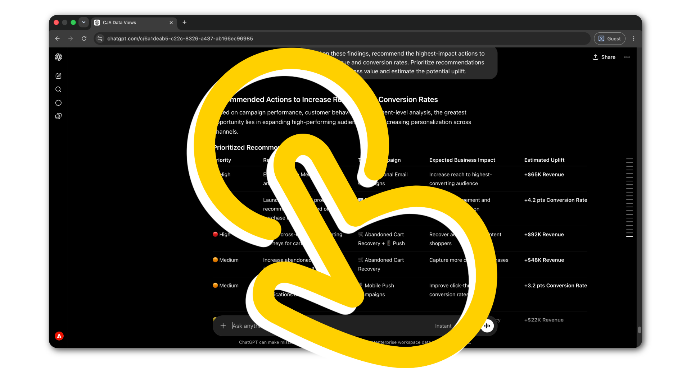
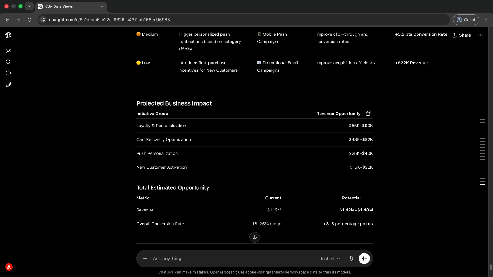
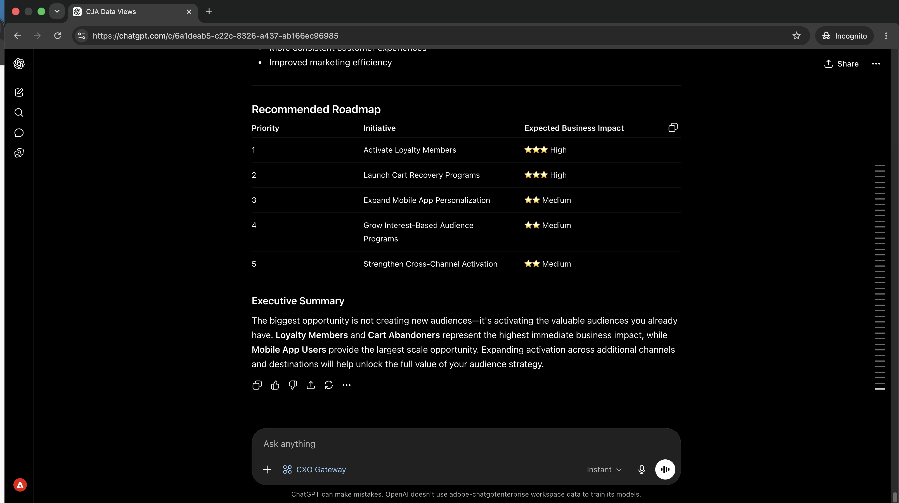
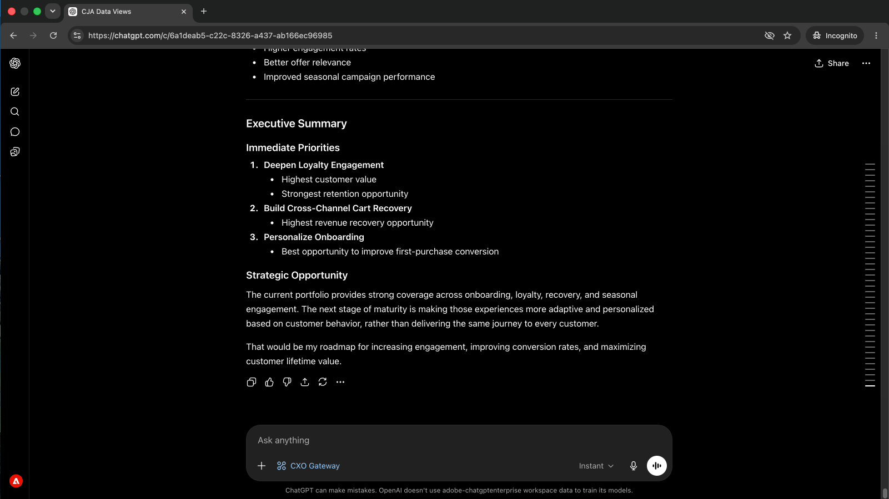
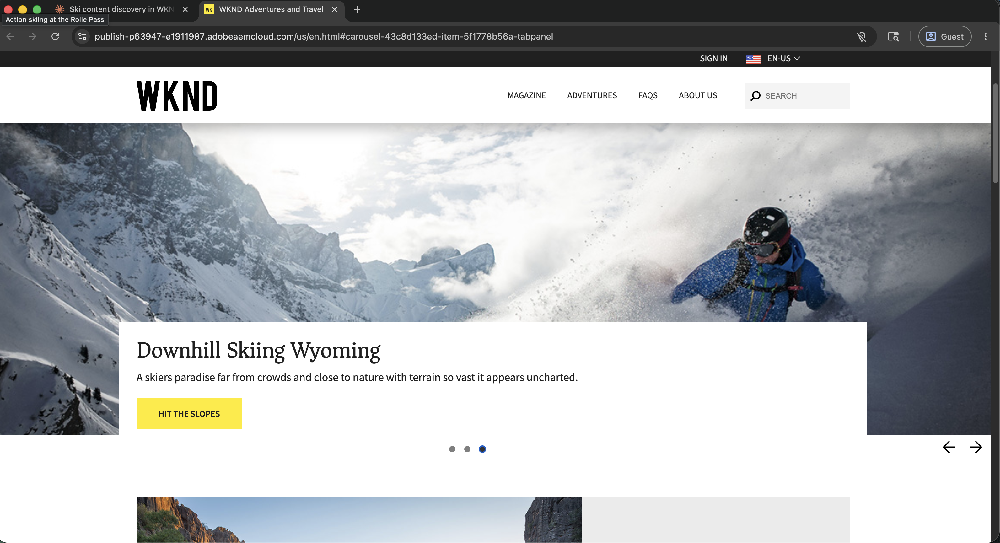
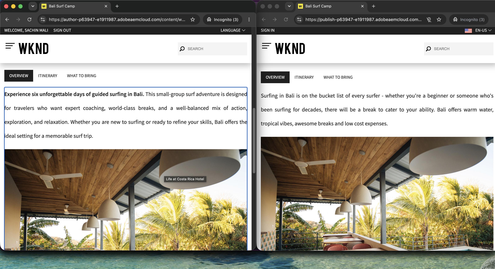
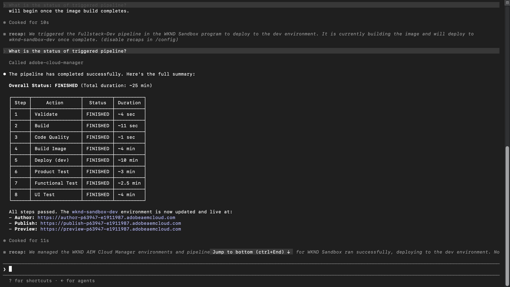

# 執行中的代理工具

<!-- last-modified: 2026-06-08 -->

實際Adobe CX Enterprise工作流程的逐步逐步解說。 每次逐步解說都會從設定結束的地方開始，並連線工具及完成真正的工作流程。

<!--
CARDS

* analyze-campaign-performance.md
  {title = Campaign insights without reports}
  {description = Ask performance questions in plain language and get answers from Customer Journey Analytics, without building a single report.}
  {cta = Surface campaign insights}

* query-audiences.md
  {title = Audience activation at a glance}
  {description = See which audiences are live, where they are flowing, and whether destinations are healthy, without navigating Real-Time CDP.}
  {cta = Check audience activation}

* manage-ajo-journeys.md
  {title = Catch journey issues early}
  {description = Monitor active journeys and surface operational issues before they reach your audience.}
  {cta = Monitor your journeys}

* manage-aem-content.md
  {title = Ship content updates faster}
  {description = Find, update, and publish AEM pages and content fragments faster, without switching to the AEM interface.}
  {cta = Ship content faster}

* optimize-content-with-performance-data.md
  {title = Close content performance gaps}
  {description = Surface conversion gaps in CJA, trace them to underperforming content in AEM, and apply the fix in a single AI session.}
  {cta = Close performance gaps}

* aem-cloud-manager-mcp.md
  {title = Deploy AEM changes with confidence}
  {description = Check environment health, review pipeline history, and deploy to AEM from your AI client, without switching tools.}
  {cta = Deploy with confidence}
  {image = ../assets/use-cases/aem-cloud-manager-mcp/aem-cloud-manager-mcp-step4-01-ai.png}
-->
<!-- START CARDS HTML - DO NOT MODIFY BY HAND -->

    

        

            

                <figure class="image x-is-16by9">
                    
                </figure>
            

            

                

                    

                        <a href="analyze-campaign-performance.md" title="不含報表的行銷活動深入分析">沒有報表的行銷活動深入分析</a>
                    

                    
以簡單的語言提出效能問題，並從Customer Journey Analytics獲得答案，而不需要建立單一報表。

                

                <a href="analyze-campaign-performance.md" class="spectrum-Button spectrum-Button--outline spectrum-Button--primary spectrum-Button--sizeM" style="align-self: flex-start; margin-top: 1rem;">
                    表面行銷活動深入分析
                
            

        

    

    

        

            

                <figure class="image x-is-16by9">
                    
                </figure>
            

            

                

                    

                        <a href="query-audiences.md" title="對象啟用總覽">對象啟用一覽</a>
                    

                    
無須導覽Real-Time CDP，即可檢視哪些對象已上線、流量在哪裡，以及目的地是否健康。

                

                <a href="query-audiences.md" class="spectrum-Button spectrum-Button--outline spectrum-Button--primary spectrum-Button--sizeM" style="align-self: flex-start; margin-top: 1rem;">
                    檢查對象啟用
                
            

        

    

    

        

            

                <figure class="image x-is-16by9">
                    
                </figure>
            

            

                

                    

                        <a href="manage-ajo-journeys.md" title="及早發現歷程問題">提早發現歷程問題</a>
                    

                    
在作用中歷程和表面操作問題觸及您的受眾之前，對其進行監視。

                

                <a href="manage-ajo-journeys.md" class="spectrum-Button spectrum-Button--outline spectrum-Button--primary spectrum-Button--sizeM" style="align-self: flex-start; margin-top: 1rem;">
                    監視您的歷程
                
            

        

    

    

        

            

                <figure class="image x-is-16by9">
                    
                </figure>
            

            

                

                    

                        <a href="manage-aem-content.md" title="加快傳送內容更新的速度">快送出內容更新</a>
                    

                    
無需切換至AEM介面，即可更快速地尋找、更新和發佈AEM頁面和內容片段。

                

                <a href="manage-aem-content.md" class="spectrum-Button spectrum-Button--outline spectrum-Button--primary spectrum-Button--sizeM" style="align-self: flex-start; margin-top: 1rem;">
                    快送內容
                
            

        

    

    

        

            

                <figure class="image x-is-16by9">
                    
                </figure>
            

            

                

                    

                        <a href="optimize-content-with-performance-data.md" title="縮小內容效能差距">關閉內容效能差距</a>
                    

                    
在CJA中顯示轉換間隙，將其追蹤至AEM中表現缺佳的內容，並在單一AI工作階段中套用修正。

                

                <a href="optimize-content-with-performance-data.md" class="spectrum-Button spectrum-Button--outline spectrum-Button--primary spectrum-Button--sizeM" style="align-self: flex-start; margin-top: 1rem;">
                    縮小效能差距
                
            

        

    

    

        

            

                <figure class="image x-is-16by9">
                    
                </figure>
            

            

                

                    

                        <a href="aem-cloud-manager-mcp.md" title="自信地部署AEM變更">部署AEM變更並保有信賴度</a>
                    

                    
檢查環境健康情況、檢閱管道歷史記錄，以及從您的AI使用者端部署到AEM，無需切換工具。

                

                <a href="aem-cloud-manager-mcp.md" class="spectrum-Button spectrum-Button--outline spectrum-Button--primary spectrum-Button--sizeM" style="align-self: flex-start; margin-top: 1rem;">
                    部署時充滿信心
                
            

        

    

<!-- END CARDS HTML - DO NOT MODIFY BY HAND -->
