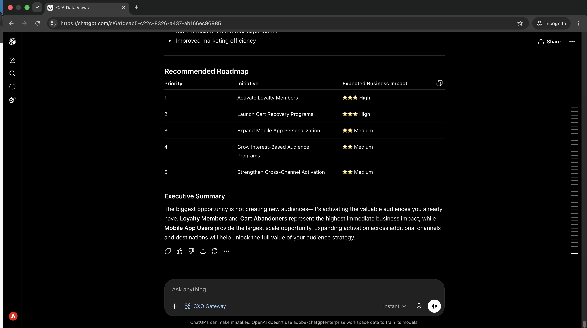
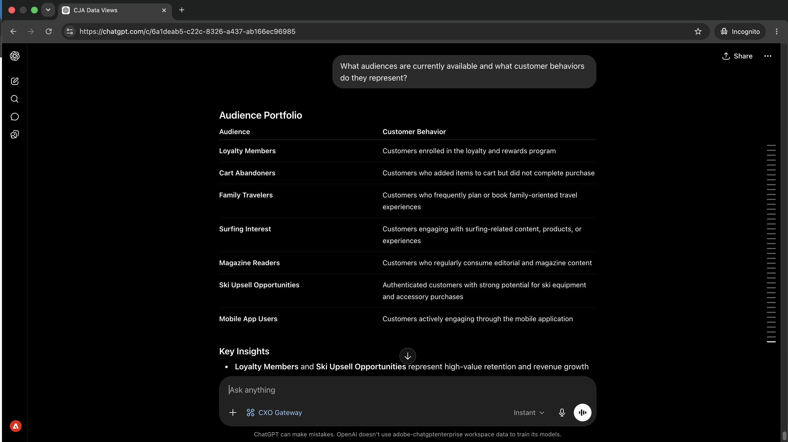
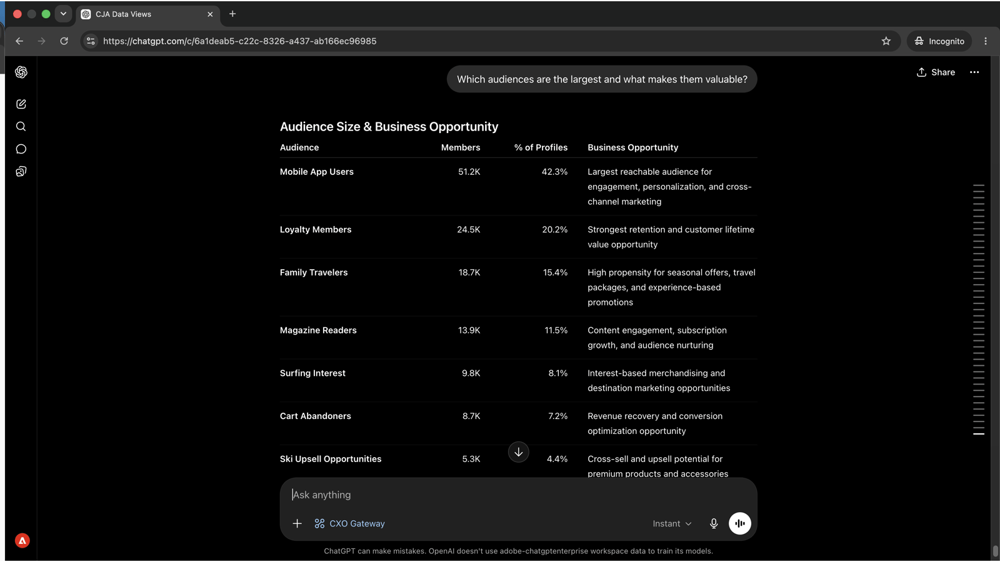
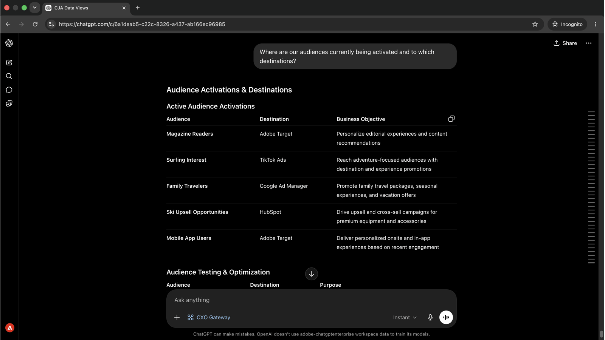
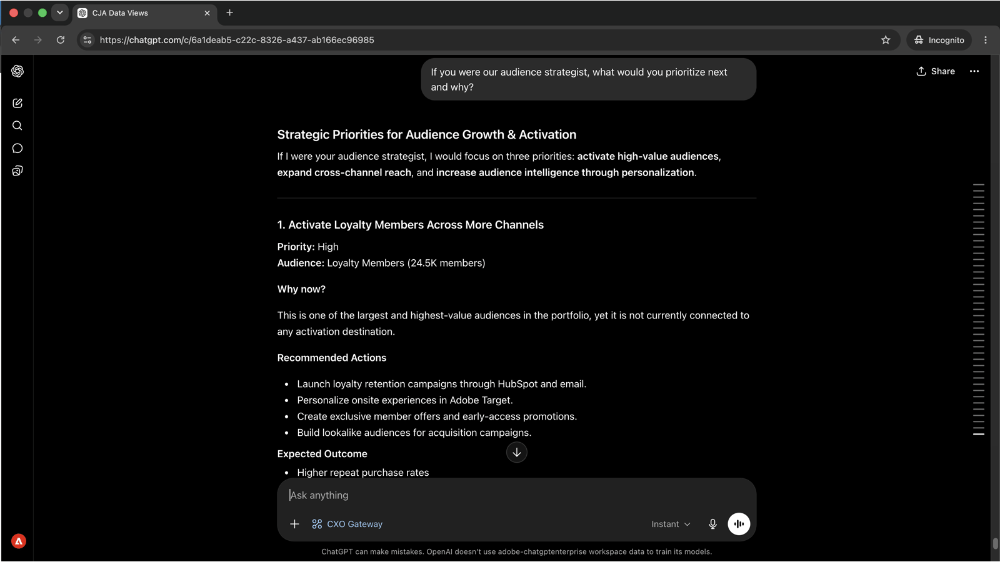

# 瞭解您的對象及其啟用位置

<!-- last-modified: 2026-06-04 -->



瞭解哪些對象是即時的、在哪裡流動，以及目的地是否健康在行銷活動開始之前或行銷活動表現不佳至關重要。 本逐步解說將展示如何透過AI使用者端取得完整的啟用圖片，使用CX Enterprise MCP在幾秒鐘內呈現對象狀態和目的地健康狀態，而不需要開啟Real-Time CDP。

| 案例詳細資料 | |
| --- | --- |
| CX企業應用程式 | [Real-Time Customer Data Platform (Real-Time CDP)](https://experienceleague.adobe.com/zh-hant/docs/experience-platform/rtcdp/home) |
| 代理工具 | [CX Enterprise MCP](../tools/mcp-servers.md#cx-enterprise-mcp-servers) |
| 客群 | 行銷人員、分析人員、操作者 |
| 先決條件 | MCP相容的AI使用者端、Real-Time CDP存取 |

每個步驟會顯示一個代表性提示和範例AI回應。 您可以完成更多&#x200B;**個**&#x200B;區段，在同一工作階段中進行更多探索。

## 開始之前

>[!BEGINTABS]

>[!TAB Claude.ai]

將CX Enterprise MCP連線為自訂聯結器，以存取Real-Time CDP工具。

1. 移至Claude.ai中的&#x200B;**設定>整合**。
2. 選取&#x200B;**新增自訂聯結器**&#x200B;並輸入伺服器URL： `https://cx-enterprise.adobe.io/mcp`
3. 選取&#x200B;**連線**&#x200B;並使用您的Adobe ID登入。

完整設定： [Claude.ai自訂聯結器檔案](https://support.claude.com/en/articles/11175166-get-started-with-custom-connectors-using-remote-mcp)

>[!TAB ChatGPT]

使用ChatGPT Developer Mode連線CX Enterprise MCP （需要Pro、Plus、Business、Enterprise或Education計畫）。

1. 在&#x200B;**ChatGPT設定**&#x200B;中啟用&#x200B;**開發人員模式**。
2. 移至&#x200B;**設定>整合**&#x200B;並選取&#x200B;**新增自訂聯結器>遠端MCP伺服器**。
3. 輸入伺服器URL： `https://cx-enterprise.adobe.io/mcp`
4. 選取&#x200B;**連線**&#x200B;並使用您的Adobe ID登入。

完整設定： [ChatGPT MCP檔案](https://developers.openai.com/api/docs/guides/tools-connectors-mcp)

>[!TAB 其他AI使用者端]

使用Gemini、Microsoft Copilot、Cursor、Claude Code或其他與MCP相容的環境嗎？ 使用此端點連線到CX Enterprise MCP：

```
https://cx-enterprise.adobe.io/mcp
```

所有支援使用者端的完整設定指示： [連線到您的AI使用者端](../tools/mcp-servers.md)

>[!ENDTABS]

>[!NOTE]
>
>出現提示時，請使用您的Adobe ID登入，並選取連結至您的Real-Time CDP執行個體的IMS組織。 選擇錯誤的組織是驗證錯誤最常見的來源。

## 步驟1：探索您的對象及其代表的意義

首先，要求一份可用對象及其擷取的客戶行為清單。 這可讓您在鑽研至任何特定區段之前擁有完整的橫向。

```
What audiences are currently available and what customer behaviors do they represent?
```

+++檢視範例回應



+++


## 步驟2：識別您最有價值的區段

檢視對象面貌，詢問哪些區段規模最大，以及哪些區段具備策略價值。

```
Which audiences are the largest and what makes them valuable?
```

+++檢視範例回應



+++


## 步驟3：檢閱啟用和目的地

詢問您的對象目前流向何處，以及他們啟用的目的地。

```
Where are our audiences currently being activated and to which destinations?
```

+++檢視範例回應



+++


## 步驟4：取得策略建議

CX Enterprise MCP的RTCDP工具是唯讀的 — 它們會顯示啟用狀態、目的地健康狀況和資料流資料，但不會修改設定。 找出問題後，應用程式就會進行修正。

```
If you were our audience strategist, what would you prioritize next and why?
```

+++檢視範例回應



+++


>[!NOTE]
>
>CX Enterprise MCP的RTCDP工具會顯示目的地和啟用資料，但無法修改目的地組態、區段定義或資料流設定。 Real-Time CDP應用程式中會進行補救步驟。

## 您完成的內容

您將AI使用者端連線至Real-Time CDP，並在四個提示中建立對象組合的策略性構想。 您將可用受眾對應至其擷取的客戶行為，識別最大且最有價值的區段，確認每個受眾流向何處以及前往何處，並在下次啟用時收到優先建議。 這以直接的策略性對話取代導覽多個Real-Time CDP畫面。

## 您可以完成更多工作

CX Enterprise MCP的Real-Time CDP工具支援廣泛的對象和啟動查詢。 展開下列案例以檢視可在相同工作階段中嘗試的提示。

+++清楚知道行銷活動傳送之前流向何處

啟用失敗是靜音的。 對象會在沒有警告的情況下停止流動，且行銷活動會傳送至過時的清單。 這些提示可讓您清楚瞭解哪些區段將到達哪些目的地及時間。

**提示**

```
Which audiences are activated to Google Ads?
```

```
Show me the activation history for the [audience name] audience.
```

```
What is the last refresh time for the [audience name] audience?
```

+++

+++在啟用問題影響行銷活動之前鎖定它們

遺漏回合的目的地或沒有有效目的地的區段，表示您的行銷活動觸及的人數可能少於預期。 這些提示會主動顯示這些間隙。

**提示**

```
Are there any audiences with no active destinations?
```

```
Are any destination dataflows showing errors right now?
```

```
Which audiences have not been updated in the last 30 days?
```

+++

+++稽核並瞭解您的對象環境

當受眾規模改變或建立新區段時，擁有清楚的詳細目錄可協助您規劃並避免啟動錯誤的清單。 這些提示可讓您隨選顯示狀態。

**提示**

```
How many profiles are in the [segment name] segment?
```

```
Show me all audiences created in the last 30 days.
```

```
Which audience has grown the most in the last 60 days?
```

```
How many total profiles are in my Real-Time CDP instance?
```

+++

+++瞭解身分和資料品質

身分名稱空間和合併原則會直接影響對象中包含的設定檔及其解析方式。 這些提示會提供表面設定詳細資料，這些詳細資料可解釋非預期的受眾大小或設定檔重疊。

**提示**

```
What identity namespaces are configured and which are most commonly used?
```

```
What merge policies are defined and which audiences use each one?
```

```
Are there any audiences using a non-default merge policy that could cause profile overlap?
```

+++


## 進一步資訊

| 資源 | 您會找到的內容 |
| --- | --- |
| [Adobe AI登入](https://developer.adobe.com/ai-registry/?type=mcp){target="_blank"} | 特定Adobe MCP伺服器的受管理聯結器和伺服器詳細資料 |
| [Real-Time CDP檔案](https://experienceleague.adobe.com/zh-hant/docs/experience-platform/rtcdp/home){target="_blank"} | 完整的Real-Time CDP應用程式檔案 |
